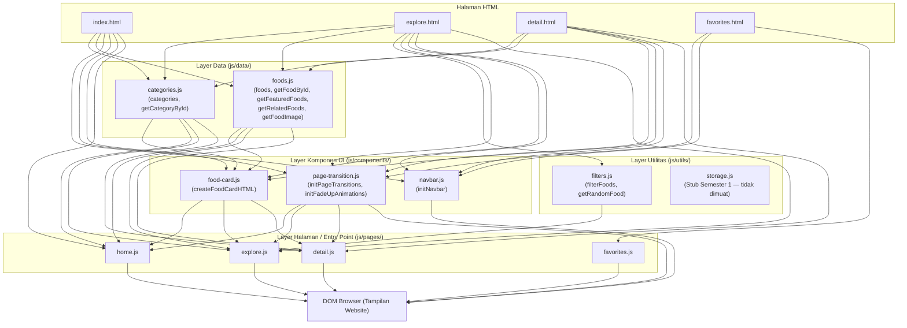

# Dokumentasi Lengkap JavaScript — Mangkasara

Dokumentasi ini menjelaskan seluruh kode JavaScript yang digunakan pada proyek **Mangkasara** (website eksplorasi dan ensiklopedia kuliner tradisional Makassar). Panduan ini ditulis dengan bahasa Indonesia yang ramah bagi pemula agar Anda dan tim dapat memahami cara kerja setiap file, fungsi, alur eksekusi, serta hubungan antarbagian kode saat mempelajarinya di VS Code.

---

## Daftar Isi

1. [Arsitektur JavaScript Proyek](#1-arsitektur-javascript-proyek)
2. [Sistem Modul: ES Modules vs Implementasi Aktual Proyek](#2-sistem-modul-es-modules-vs-implementasi-aktual-proyek)
3. [Dokumentasi Lengkap Setiap File JavaScript](#3-dokumentasi-lengkap-setiap-file-javascript)
   - [3.1 `js/data/categories.js`](#31-jsdatacategoriesjs)
   - [3.2 `js/data/foods.js`](#32-jsdatafoodsjs)
   - [3.3 `js/utils/filters.js`](#33-jsutilsfiltersjs)
   - [3.4 `js/utils/storage.js`](#34-jsutilsstoragejs)
   - [3.5 `js/components/navbar.js`](#35-jscomponentsnavbarjs)
   - [3.6 `js/components/page-transition.js`](#36-jscomponentspage-transitionjs)
   - [3.7 `js/components/food-card.js`](#37-jscomponentsfood-cardjs)
   - [3.8 `js/pages/home.js`](#38-jspageshomejs)
   - [3.9 `js/pages/explore.js`](#39-jspagesexplorejs)
   - [3.10 `js/pages/detail.js`](#310-jspagesdetailjs)
   - [3.11 `js/pages/favorites.js`](#311-jspagesfavoritesjs)
4. [Konsep Penting JavaScript yang Digunakan](#4-konsep-penting-javascript-yang-digunakan)
5. [Cara Kerja Setiap Fitur Website](#5-cara-kerja-setiap-fitur-website)
6. [Alur Eksekusi Lengkap JavaScript (End-to-End)](#6-alur-eksekusi-lengkap-javascript-end-to-end)

---

## 1. Arsitektur JavaScript Proyek

Seluruh kode JavaScript pada proyek Mangkasara disimpan di dalam folder `js/` dan dibagi menjadi **4 sub-folder** sesuai tanggung jawabnya masing-masing:

| Folder | Tanggung Jawab | Daftar File |
|---|---|---|
| `js/data/` | Menyimpan data master statis (kategori & 25 kuliner Makassar) beserta fungsi helper pencarian data. | `categories.js`, `foods.js` |
| `js/utils/` | Menyimpan fungsi utilitas (logika penyaringan, pencarian, pemilihan acak) dan stub penyimpanan. | `filters.js`, `storage.js` |
| `js/components/` | Menyimpan komponen antarmuka (UI) yang dipakai berulang di berbagai halaman. | `navbar.js`, `page-transition.js`, `food-card.js` |
| `js/pages/` | Menyimpan skrip pengendali utama (*entry point* logika halaman) untuk masing-masing file HTML. | `home.js`, `explore.js`, `detail.js`, `favorites.js` |

### Pemetaan Halaman HTML ke Skrip JavaScript

Setiap halaman HTML memuat skrip secara berurutan di bagian bawah `<body>` (sebelum tag penutup `</body>`). Urutan pemuatan sangat penting karena skrip yang dimuat belakangan bergantung pada variabel dan fungsi dari skrip yang dimuat lebih awal:

1. **`index.html` (Beranda)**
   - Memuat: `categories.js` → `foods.js` → `page-transition.js` → `food-card.js` → `navbar.js` → **`home.js`** *(entry point halaman)*
2. **`explore.html` (Jelajah Kuliner)**
   - Memuat: `categories.js` → `foods.js` → `filters.js` → `page-transition.js` → `food-card.js` → `navbar.js` → **`explore.js`** *(entry point halaman)*
3. **`detail.html` (Detail Kuliner)**
   - Memuat: `categories.js` → `foods.js` → `page-transition.js` → `food-card.js` → `navbar.js` → **`detail.js`** *(entry point halaman)*
4. **`favorites.html` (Favorit — Coming Soon)**
   - Memuat: `page-transition.js` → `navbar.js` → **`favorites.js`** *(entry point halaman)*

> **Catatan:** File `js/utils/storage.js` ada di dalam folder `js/utils/`, tetapi **tidak dimuat** oleh halaman HTML mana pun pada tahap Semester 1 karena fitur favorit berbasis LocalStorage ditangguhkan ke Semester 2.

### Diagram Ketergantungan Modul & Aliran Data



---

## 2. Sistem Modul: ES Modules vs Implementasi Aktual Proyek

Bagian ini sangat penting dipahami agar tidak bingung ketika membaca tutorial JavaScript modern (*ES Modules*) dan membandingkannya dengan kode proyek Mangkasara.

### A. Apakah Proyek Ini Menggunakan ES Modules (`import` / `export`)?

**Tidak.** Pada sisi browser (HTML), proyek Mangkasara **belum menggunakan ES Modules** (`<script type="module">`, `import`, atau `export`). Alasannya sangat praktis untuk proyek frontend statis Semester 1:
- Jika memakai `<script type="module">`, browser memblokir pemuatan modul saat file HTML dibuka langsung melalui protokol `file://` (double-click `index.html`) karena aturan keamanan *CORS*.
- Dengan memakai tag `<script src="..."></script>` biasa (**Classic Scripts**), website tetap berjalan lancar baik saat dibuka langsung lewat `file://` maupun lewat web server lokal/hosting.

Sebagai gantinya, proyek ini menggunakan **2 mekanisme berbagi kode**:

1. **Global Scope Browser (untuk website di browser):**
   Semua variabel tingkat atas (`const categories`, `const foods`) dan fungsi (`function getFoodById`, `function createFoodCardHTML`, `function filterFoods`, dll.) yang dideklarasikan di satu file `<script>` otomatis terdaftar di lingkup global browser. File `<script>` berikutnya bisa langsung memanggil fungsi atau membaca variabel tersebut tanpa menulis `import`.
   Selain itu, pada `js/components/page-transition.js` baris 101, ada penempelan eksplisit ke objek global `window`:
   ```javascript
   window.initFadeUpAnimations = initFadeUpAnimations;
   ```
   Tujuannya memastikan `initFadeUpAnimations` pasti tersedia secara global untuk dipanggil oleh `home.js`, `explore.js`, dan `detail.js`.

2. **CommonJS Export Kondisional (`module.exports`) untuk Node.js:**
   Pada 4 file (`js/data/categories.js`, `js/data/foods.js`, `js/utils/filters.js`, dan `js/components/food-card.js`), di bagian paling bawah terdapat blok kode seperti ini (contoh dari `js/data/categories.js` baris 80–82):
   ```javascript
   if (typeof module !== "undefined" && module.exports) {
     module.exports = { categories, getCategoryById };
   }
   ```
   - **Cara kerjanya:** Di browser, objek `module` tidak ada (`typeof module === "undefined"`), sehingga blok `if` ini dilewati dan tidak menimbulkan error. Namun jika file tersebut dijalankan di lingkungan Node.js (misalnya untuk pengecekan data atau unit test), `module.exports` tersedia sehingga data dan fungsi bisa diekspor dan dipanggil dengan `require('./js/data/categories.js')`.

### B. Ringkasan Ekspor Kondisional yang Ada di Proyek

| File Sumber | Nilai yang Diekspor via `module.exports` | Penggunaan |
|---|---|---|
| `js/data/categories.js` | `categories`, `getCategoryById` | Dipakai global di browser oleh `food-card.js`, `home.js`, `explore.js`, `detail.js`. |
| `js/data/foods.js` | `foods`, `getFoodById`, `getFoodBySlug`, `getFeaturedFoods`, `getFoodsByCategory`, `getRelatedFoods`, `getFoodImage` | Dipakai global di browser oleh `food-card.js`, `home.js`, `explore.js`, `detail.js`. |
| `js/utils/filters.js` | `filterFoods`, `getRandomFood`, `searchFoodsByName`, `filterFoodsByCategory` | Dipakai global di browser oleh `explore.js`. |
| `js/components/food-card.js` | `createFoodCardHTML`, `attachFavoriteButtonListeners` | Dipakai global di browser oleh `home.js`, `explore.js`, `detail.js`. |

### C. Mengenal Konsep ES Modules (`import` / `export`) Sebagai Pembanding

Jika di masa depan proyek ini ditingkatkan menggunakan **ES Modules** (`<script type="module">`), Anda akan menemui istilah berikut:

1. **Named Export vs Default Export:**
   - **Named Export** mengekspor banyak nilai dengan nama masing-masing:
     ```javascript
     export const categories = [ ... ];
     export function getCategoryById(id) { ... }
     ```
   - **Default Export** mengekspor satu nilai utama dari sebuah file:
     ```javascript
     export default function initHomePage() { ... }
     ```
2. **Named Import vs Default Import:**
   - **Named Import** harus menggunakan kurung kurawal `{ }` dan nama yang sama dengan yang diekspor:
     ```javascript
     import { categories, getCategoryById } from "../data/categories.js";
     ```
   - **Default Import** tidak memakai kurung kurawal dan bebas memberi nama lokal:
     ```javascript
     import initHomePage from "./home.js";
     ```
3. **Path Relatif (`./` dan `../`):**
   - `./` berarti **folder saat ini** (contoh: dari `js/pages/home.js` ke `./explore.js`).
   - `../` berarti **naik satu folder ke atas** (contoh: dari `js/pages/home.js` naik ke `js/`, lalu masuk ke `data/foods.js` menjadi `../data/foods.js`).

> **Kesimpulan:** Saat ini Mangkasara mengandalkan **urutan tag `<script>` di HTML** (global scope) + **`module.exports` (CommonJS)** untuk kompatibilitas Node.js, bukan ES Modules `import`/`export`.

---

## 3. Dokumentasi Lengkap Setiap File JavaScript

### 3.1 `js/data/categories.js`

#### A. Tujuan File
File ini menyimpan **data master 5 kategori kuliner Makassar** beserta satu fungsi pembantu (`getCategoryById`) untuk mencari objek kategori berdasarkan ID angkanya.
- **Digunakan oleh halaman:** `index.html`, `explore.html`, `detail.html`.
- **Ketergantungan:** Tidak bergantung pada file JS lain (harus dimuat paling awal).

#### B. Kode Sumber Lengkap

```javascript
/**
 * ==============================================================================
 * MANGKASARA — DATA KATEGORI KULINER
 * ==============================================================================
 * File ini menyimpan data master kategori kuliner tradisional Makassar.
 * Setiap kategori memiliki:
 * - id: Identitas angka unik yang dihubungkan dengan categoryId pada makanan.
 * - name: Nama kategori yang ditampilkan pada antarmuka (UI).
 * - slug: Representasi nama yang ramah URL (URL-friendly string).
 * - description: Penjelasan singkat karakter kategori kuliner.
 * - icon: Simbol visual pendukung untuk card kategori pada beranda.
 * 
 * Penggunaan di aplikasi:
 * - Digunakan oleh filter kategori pada halaman Explore (`explore.html`).
 * - Digunakan untuk menampilkan card kategori pada Beranda (`index.html`).
 * - Digunakan untuk mencari nama kategori pada halaman Detail (`detail.html`).
 * ==============================================================================
 */

const categories = [
  {
    id: 1,
    name: "Hidangan Berkuah",
    slug: "hidangan-berkuah",
    description: "Kelezatan aneka sup dan hidangan berkuah kaya rempah khas Makassar.",
    icon: "🍲"
  },
  {
    id: 2,
    name: "Makanan Utama",
    slug: "makanan-utama",
    description: "Santapan pokok pengenyang yang kaya tradisi dan cita rasa otentik.",
    icon: "🍚"
  },
  {
    id: 3,
    name: "Olahan Ikan & Seafood",
    slug: "olahan-ikan-seafood",
    description: "Kekayaan kuliner hasil laut Selat Makassar dengan bumbu khas pesisir.",
    icon: "🐟"
  },
  {
    id: 4,
    name: "Camilan & Jajanan",
    slug: "camilan-jajanan",
    description: "Kudapan renyah dan jajanan jalanan legendaris pelepas rasa lapar.",
    icon: "🥟"
  },
  {
    id: 5,
    name: "Kue & Hidangan Manis",
    slug: "kue-hidangan-manis",
    description: "Kudapan penutup manis tradisional berbahan dasar pisang dan santan.",
    icon: "🍧"
  }
];

/**
 * Mendapatkan objek kategori berdasarkan ID.
 *
 * Mengapa fungsi ini diperlukan:
 * Pada halaman detail dan card makanan, data makanan hanya menyimpan `categoryId` (misal 1).
 * Fungsi ini mencocokkan angka tersebut dengan daftar kategori untuk mengambil nama lengkapnya.
 *
 * Parameter:
 * @param {number|string} categoryId - ID kategori yang ingin dicari.
 * 
 * Return:
 * @returns {object|undefined} Objek kategori yang cocok, atau undefined jika tidak ditemukan.
 *
 * Method yang digunakan:
 * - find(): Mencari satu elemen di dalam array yang memenuhi kondisi perbandingan.
 * - Number(): Mengubah parameter string menjadi tipe data number agar perbandingan akurat.
 */
function getCategoryById(categoryId) {
  return categories.find((cat) => cat.id === Number(categoryId));
}

// Mendukung ekspor modul jika dijalankan di Node.js / module bundler
if (typeof module !== "undefined" && module.exports) {
  module.exports = { categories, getCategoryById };
}
```

#### C. Penjelasan Detail

1. **Baris 20–56 (`const categories = [...]`)**:
   - **Apa yang dilakukan:** Mendeklarasikan array konstan bernama `categories` berisi 5 objek.
   - **Mengapa diperlukan:** Menjadi sumber data tunggal (*Single Source of Truth*) agar nama dan deskripsi kategori konsisten di Beranda, Explore, dan Detail.
   - **Cara kerja:** Setiap objek di dalam array memiliki properti `id` (angka `1`–`5`), `name` (teks), `slug`, `description`, dan `icon`. Array ini dibaca oleh `home.js` (untuk membuat 5 kartu kategori) dan `explore.js` (untuk membuat tombol filter kategori).
2. **Baris 75–77 (`function getCategoryById(categoryId)`)**:
   - **Tujuan:** Mengubah angka `categoryId` pada data makanan menjadi objek kategori lengkap (terutama untuk mengambil `name`).
   - **Parameter:** `categoryId` (`number` atau `string`, misalnya `1` atau `"1"` dari URL).
   - **Nilai kembalian (*return*):** Objek kategori yang cocok, atau `undefined` jika ID tidak ada.
   - **Cara kerja:** Method `.find()` memeriksa setiap elemen `cat` di `categories`. Fungsi `Number(categoryId)` memastikan jika input berupa teks `"1"`, tetap cocok dengan `cat.id` (`1`) saat dibandingkan dengan operator kesetaraan ketat `===`.
   - **Pemanggil fungsi:** `createFoodCardHTML()` (`food-card.js`), `updateFoodDisplay()` & `showRandomCulinary()` (`explore.js`), dan `renderFoodDetail()` (`detail.js`).
3. **Baris 80–82 (`if (typeof module !== "undefined" && module.exports)`)**:
   - Mengekspor `categories` dan `getCategoryById` untuk lingkungan Node.js tanpa menyebabkan error di browser.

---

### 3.2 `js/data/foods.js`

#### A. Tujuan File
File ini adalah pusat data (*Single Source of Truth*) yang menyimpan **25 objek kuliner tradisional Makassar** beserta 6 fungsi helper untuk mengambil dan memfilter data tersebut.
- **Digunakan oleh halaman:** `index.html`, `explore.html`, `detail.html`.
- **Ketergantungan:** Secara struktur data, `categoryId` pada setiap makanan merujuk ke `id` di `categories.js`, meski secara kode tidak memanggil `categories.js` secara langsung.

#### B. Kode Sumber Lengkap

```javascript
/**
 * ==============================================================================
 * MANGKASARA — DATA KULINER TRADISIONAL MAKASSAR (25 HIDANGAN)
 * ==============================================================================
 * File ini berisi kumpulan data 25 kuliner tradisional Makassar yang terbagi
 * ke dalam 5 kategori utama. Data ini berfungsi sebagai Single Source of Truth
 * untuk seluruh halaman website (Beranda, Explore, Detail, dan Favorit).
 *
 * Struktur Kontrak Data (Data Contract):
 * - id {number}              : Identitas unik dan stabil untuk setiap makanan.
 * - slug {string}            : URL-friendly identifier.
 * - name {string}            : Nama kuliner tradisional.
 * - categoryId {number}      : ID kategori (1: Berkuah, 2: Utama, 3: Ikan/Seafood, 4: Camilan, 5: Manis).
 * - shortDescription {string}: Ringkasan 1 kalimat untuk card preview.
 * - description {string}     : Deskripsi lengkap berdasarkan dokumentasi kuliner terpercaya.
 * - ingredients {string[]}   : Daftar bahan-bahan utama.
 * - preparationSteps {string[]}: Tahapan ringkas dan berurutan cara pembuatan hidangan tradisional.
 * - characteristics {string} : Profil cita rasa dan karakteristik tekstur.
 * - history {string|null}    : Catatan sejarah terverifikasi (null jika belum terverifikasi).
 * - image {string|null}      : Path foto lokal jika sudah tersedia, atau null jika menunggu dokumentasi.
 * - tags {string[]}          : Label bahan utama, metode masak, atau rasa.
 * - sources {string[]}       : Sumber rujukan literatur dan dokumentasi budaya.
 * - featured {boolean}       : Penanda apakah hidangan ditampilkan pada sorotan Beranda.
 *
 * PANDUAN PENAMBAHAN FOTO BARU OLEH TIM:
 * Ketika foto baru dimasukkan ke folder `assets/images/`, tim HANYA perlu
 * memperbarui properti `image` pada objek makanan bersangkutan di file ini.
 * Contoh: `image: "assets/images/sop-konro.jpg"`. Seluruh tampilan UI akan
 * secara otomatis menampilkan foto tersebut tanpa perlu mengubah kode HTML/UI.
 * ==============================================================================
 */

const foods = [
  // ----------------------------------------------------------------------------
  // KATEGORI 01: HIDANGAN BERKUAH (ID: 1)
  // ----------------------------------------------------------------------------
  {
    id: 1,
    slug: "coto-makassar",
    name: "Coto Makassar",
    categoryId: 1,
    shortDescription: "Hidangan sup daging dan jeroan sapi legendaris Makassar dengan kuah kental berempah dan kacang tanah sangrai.",
    description: "Coto Makassar adalah salah satu ikon kuliner tertua dan paling terkenal dari Makassar. Hidangan ini berupa sup daging dan jeroan sapi yang dimasak perlahan bersama puluhan jenis rempah aromatik khas serta kacang tanah sangrai yang digiling halus untuk memberikan tekstur kuah yang gurih, pekat, dan mendalam. Biasanya dinikmati bersama ketupat daun pandan atau buras serta sambal tauco yang khas.",
    ingredients: [
      "Daging sapi bagian sengkel atau has dalam",
      "Jeroan sapi (babat, paru, hati, usus)",
      "Kacang tanah sangrai giling halus",
      "Serai, lengkuas, dan jahe",
      "Ketumbar, jintan, dan merica sangrai",
      "Bawang merah dan bawang putih",
      "Air tajin (cucian beras putih pertama)"
    ],
    preparationSteps: [
      "Rebus daging sapi dan jeroan bersama serai, lengkuas, jahe, dan daun salam menggunakan air tajin (cucian beras pertama) hingga empuk.",
      "Angkat daging dan jeroan matang, tiriskan lalu potong berbentuk dadu sedang. Sisihkan air kaldu rebusannya.",
      "Haluskan bumbu rempah seperti bawang merah, bawang putih, ketumbar, jintan, dan merica yang telah disangrai.",
      "Tumis bumbu halus dengan sedikit minyak hingga matang dan harum, lalu masukkan ke dalam panci kuah kaldu.",
      "Tambahkan kacang tanah sangrai yang telah digiling sangat halus ke dalam kuah mendidih, aduk rata hingga kuah mengental dan gurih.",
      "Sajikan panas dalam mangkuk bersama ketupat atau buras, irisan daun bawang, bawang goreng, perasan jeruk nipis, dan sambal tauco."
    ],
    characteristics: "Kuah kental berwarna kecokelatan dengan aroma rempah pekat, tekstur daging empuk, dan cita rasa gurih legit kacang yang khas.",
    history: "Coto Makassar diyakini telah ada sejak era Kerajaan Gowa pada abad ke-16. Pada mulanya, bagian daging sirloin atau has dalam disajikan khusus untuk bangsawan dan raja di istana, sementara bagian jeroan diolah untuk masyarakat umum dan prajurit. Seiring waktu, sajian ini berkembang menjadi kuliner rakyat yang dinikmati oleh seluruh lapisan masyarakat.",
    image: "assets/images/coto.jpg",
    tags: ["Daging sapi", "Rebus", "Gurih"],
    sources: [
      "Dinas Kebudayaan dan Pariwisata Kota Makassar",
      "Dokumentasi Warisan Budaya Takbenda Indonesia — Kemendikbudristek"
    ],
    featured: true
  },
  {
    id: 2,
    slug: "pallubasa",
    name: "Pallubasa",
    categoryId: 1,
    shortDescription: "Hidangan daging sapi berkuah kaya rempah dengan taburan serundeng kelapa sangrai dan kuning telur mentah (alas).",
    description: "Pallubasa adalah kuliner berkuah khas Makassar yang memiliki kemiripan visual dengan Coto Makassar, namun dengan proses pengolahan dan profil rasa yang berbeda. Keunikan utama Pallubasa terletak pada kuahnya yang dicampur kelapa parut sangrai yang ditumbuk halus, memberikan aroma smokey kelapa dan rasa gurih yang khas. Sering disajikan dengan tambahan kuning telur ayam kampung mentah yang diaduk panas-panas di dalam kuah (disebut 'alas').",
    ingredients: [
      "Daging sapi dan jeroan sapi",
      "Kelapa parut sangrai (serundeng halus)",
      "Kuning telur ayam kampung (alas)",
      "Serai, lengkuas, dan asam jawa",
      "Ketumbar dan jintan bubuk",
      "Bawang merah dan bawang putih",
      "Gula merah dan garam"
    ],
    preparationSteps: [
      "Rebus potongan daging sapi dan jeroan dalam air mendidih bersama memaran serai dan lengkuas hingga empuk.",
      "Haluskan bumbu rempah yang terdiri dari bawang merah, bawang putih, ketumbar sangrai, jintan, cabai, dan jahe.",
      "Tumis bumbu halus hingga harum dan tanak, kemudian tuang ke dalam panci rebusan kaldu daging.",
      "Bumbui kuah dengan air asam jawa, gula merah, dan garam secukupnya untuk menghasilkan paduan rasa gurih segar.",
      "Masukkan kelapa parut yang telah disangrai kecokelatan dan ditumbuk halus ke dalam kuah mendidih, aduk hingga kuah bertekstur kental beraroma khas.",
      "Sajikan panas dalam mangkuk, tambahkan kuning telur ayam kampung mentah (alas) jika diinginkan, dan nikmati bersama nasi putih hangat."
    ],
    characteristics: "Kuah bertekstur agak kasar karena serundeng kelapa, gurih pekat beraroma sangrai, dan creamy jika ditambah kuning telur.",
    history: "Nama 'Pallubasa' berasal dari bahasa Makassar, yaitu 'pallu' yang berarti memasak dan 'basa' yang berarti basah atau berkuah. Dahulu merupakan makanan para pekerja pelabuhan dan buruh karena kalorinya yang tinggi dan mengenyangkan.",
    image: "assets/images/pallubasa.jpg",
    tags: ["Daging sapi", "Rebus", "Gurih"],
    sources: [
      "Dinas Pariwisata Kota Makassar",
      "Ensiklopedi Kuliner Tradisional Nusantara"
    ],
    featured: true
  },
  {
    id: 3,
    slug: "sop-konro",
    name: "Sop Konro",
    categoryId: 1,
    shortDescription: "Sup iga sapi berukuran besar berkuah gelap aromatik dari racikan buah kluwek dan rempah pilihan.",
    description: "Sop Konro adalah hidangan sup iga sapi khas Makassar yang tersohor dengan kuahnya yang berwarna gelap kehitaman alami dari buah kluwek (keluwek). Potongan tulang iga yang besar dengan daging empuk yang merekat dimasak hingga bumbu meresap sempurna sampai ke serat tulang. Disajikan panas bersama potongan ketupat atau nasi putih, perasan jeruk nipis, dan sambal cabai rawit pedas.",
    ingredients: [
      "Iga sapi berdaging tebal",
      "Buah kluwek tua berkualitas",
      "Kayu manis, cengkeh, dan kapulaga",
      "Biji pala dan daun salam",
      "Serai dan lengkuas",
      "Bawang merah dan bawang putih",
      "Ketumbar dan merica"
    ],
    preparationSteps: [
      "Cuci bersih iga sapi berdaging tebal, lalu rebus dalam air mendidih bersama daun salam, serai, dan kayu manis hingga daging iga empuk lembut.",
      "Rendam buah kluwek tua dengan air hangat, ambil daging buahnya lalu haluskan bersama bawang merah, bawang putih, ketumbar, jintan, pala, dan merica.",
      "Tumis bumbu kluwek halus bersama cengkeh dan kapulaga hingga harum dan matang sempurna.",
      "Masukkan tumisan bumbu ke dalam panci rebusan iga, aduk rata hingga kuah berubah warna menjadi gelap kehitaman khas konro.",
      "Bumbui dengan garam dan sedikit gula, masak dengan api kecil agar bumbu rempah meresap ke dalam pori-pori daging iga dan tulang.",
      "Sajikan panas bersama taburan bawang goreng, irisan seledri, perasan jeruk nipis, dan sambal cabai rawit pedas."
    ],
    characteristics: "Kuah pekat gurih beraroma rempah hangat dan kluwek yang earthy, berpadu dengan daging iga lembut yang juicy.",
    history: "Konro merupakan sajian tradisional yang berakar dari masyarakat Bugis-Makassar. Pada mulanya disajikan pada upacara adat atau perayaan hari besar, kini Konro telah menjadi salah satu kuliner Nusantara yang paling tersohor.",
    image: "assets/images/sop-konro.jpg",
    tags: ["Daging sapi", "Rebus", "Gurih"],
    sources: [
      "Pemerintah Kota Makassar",
      "Warisan Kuliner Tradisional Indonesia"
    ],
    featured: true
  },
  {
    id: 4,
    slug: "sop-saudara",
    name: "Sop Saudara",
    categoryId: 1,
    shortDescription: "Sup daging sapi kaya rempah dengan isian pelengkap unik berupa bihun soun dan perkedel kentang.",
    description: "Sop Saudara adalah hidangan sup daging sapi khas Pangkep yang sangat populer di Makassar. Sup ini dimasak dengan racikan bumbu rempah aromatik seperti serai, pala, dan kayu manis, lalu disajikan dalam mangkuk bersama sohun, perkedel kentang goreng gurih, dan taburan bawang goreng. Dinikmati bersama nasi hangat dan ikan bakar bandeng.",
    ingredients: [
      "Daging sapi bagian sandung lamur",
      "Paru sapi goreng garing",
      "Bihun / soun lembut",
      "Perkedel kentang goreng",
      "Bawang merah dan bawang putih",
      "Serai, jahe, dan kayu manis",
      "Pala bubuk dan kaldu sapi"
    ],
    preparationSteps: [
      "Rebus daging sapi bagian has dalam atau sengkel hingga empuk, potong dadu kecil, lalu sisihkan kuah kaldunya.",
      "Siapkan bahan pelengkap khas: goreng perkedel kentang kecil dan potongan paru sapi hingga kering renyah.",
      "Haluskan bumbu rempah seperti bawang merah, bawang putih, kemiri, ketumbar, jintan, lengkuas, dan jahe.",
      "Tumis bumbu halus hingga harum, masukkan ke dalam air kaldu rebusan daging, lalu tambahkan sedikit susu evaporasi atau santan encer agar kuah gurih lembut.",
      "Tata bihun atau soun seduh di dasar mangkuk, tambahkan potongan daging sapi empuk, perkedel kentang, dan irisan paru goreng renyah.",
      "Siram dengan kuah rempah mendidih, taburi daun bawang serta bawang goreng, dan santap bersama nasi putih hangat atau ikan bakar."
    ],
    characteristics: "Kuah harum rempah ringan namun gurih, dipadukan dengan kelembutan soun dan tekstur renyah-lembut perkedel kentang.",
    history: "Diciptakan pertama kali oleh H. Dollahi pada era 1950-an di Pangkajene (Pangkep), yang kemudian membuka cabang di Makassar. Nama 'Saudara' diambil dari filosofi persaudaraan bahwa siapa pun yang singgah menyantap sup ini dianggap sebagai saudara.",
    image: "assets/images/sop-saudara.jpg",
    tags: ["Daging sapi", "Rebus", "Gurih"],
    sources: [
      "Kajian Gastronomi Sulawesi Selatan — Balai Pelestarian Nilai Budaya"
    ],
    featured: false
  },
  {
    id: 5,
    slug: "sop-ubi",
    name: "Sop Ubi",
    categoryId: 1,
    shortDescription: "Perpaduan segar sup kaldu sapi gurih dengan singkong goreng empuk, sohun, dan tauge renyah.",
    description: "Sop Ubi adalah kuliner legendaris khas Makassar yang unik karena memadukan potongan singkong (ubi kayu) yang digoreng terlebih dahulu hingga renyah di luar dan lembut di dalam, lalu diguyur kuah kaldu sapi bening yang gurih panas. Isian lainnya meliputi potongan daging sapi empuk, sohun, tauge segar, kacang goreng, dan seledri.",
    ingredients: [
      "Singkong (ubi kayu) empuk goreng potong dadu",
      "Daging sapi / tetelan lembut",
      "Kaldu sapi murni gurih",
      "Sohun / bihun",
      "Tauge segar",
      "Kacang tanah goreng renyah",
      "Bawang goreng dan seledri cincang"
    ],
    preparationSteps: [
      "Kupas singkong (ubi kayu), potong dadu sedang, lalu goreng dalam minyak panas hingga bagian luarnya renyah dan bagian dalamnya empuk mereka.",
      "Rebus daging sapi atau tetelan bersama daun salam dan serai hingga menghasilkan kaldu sapi yang gurih dan bening.",
      "Haluskan bawang putih, bawang merah, merica butir, dan pala, lalu tumis hingga harum dan masukkan ke dalam panci kuah kaldu sapi.",
      "Siapkan mangkuk saji, susun singkong goreng hangat, bihun seduh, tauge pendek, dan potongan daging sapi rebus.",
      "Siramkan kuah kaldu sapi panas mendidih ke atas susunan bahan di mangkuk.",
      "Beri taburan kacang tanah goreng, irisan seledri, bawang goreng renyah, potongan telur rebus, dan sambal cabai rawit kuning khas Makassar."
    ],
    characteristics: "Perpaduan rasa gurih kaldu sapi dengan manis-lembut singkong goreng yang menyerap kuah secara nikmat.",
    history: null,
    image: "assets/images/sop-ubi.jpg",
    tags: ["Daging sapi", "Rebus", "Gurih"],
    sources: [
      "Arsip Kuliner Rakyat Kota Makassar"
    ],
    featured: false
  },
  {
    id: 6,
    slug: "pallumara",
    name: "Pallumara",
    categoryId: 1,
    shortDescription: "Sop ikan tradisional berkuah kuning cerah dengan paduan rasa segar asam jawa dan kunyit aromatik.",
    description: "Pallumara adalah masakan sup ikan khas Bugis-Makassar dengan kuah kuning bening yang menonjolkan rasa asam dan pedas segar. Warna kuning diperoleh dari kunyit segar, sedangkan rasa asamnya berasal dari asam jawa (mangga muda atau belimbing wuluh juga sering digunakan). Biasanya menggunakan kepala atau badan ikan kakap merah, ikan bandeng, atau ikan tongkol.",
    ingredients: [
      "Ikan kakap merah / bandeng segar",
      "Kunyit segar diparut halus",
      "Asam jawa matang",
      "Bawang merah iris",
      "Cabai rawit utuh",
      "Serai dimemarkan",
      "Garam dan minyak kelapa"
    ],
    preparationSteps: [
      "Bersihkan ikan segar (bandeng, kakap, atau tongkol), potong sesuai selera, lumuri dengan garam dan sedikit air perasan jeruk nipis untuk menghilangkan aroma amis.",
      "Larutkan asam jawa matang dengan air bersih secukupnya, saring dan buang ampas serta bijinya.",
      "Iris tipis bawang merah dan haluskan kunyit segar untuk memberikan warna kuning cerah alami.",
      "Masukkan air asam jawa ke dalam panci tanah liat atau wajan, tambahkan irisan bawang merah, kunyit, garam, dan cabai rawit utuh.",
      "Didihkan kuah asam kunyit, kemudian masukkan potongan ikan segar secara perlahan agar bentuknya tetap utuh dan tidak hancur.",
      "Masak dengan api sedang hingga ikan matang sempurna dan kuahnya terasa asam, gurih, dan menyegarkan."
    ],
    characteristics: "Cita rasa dominan asam menyegarkan berpadu gurih ikan laut alami dan sedikit sengatan pedas cabai rawit.",
    history: "Berasal dari kata 'pallu' (memasak) dan 'mara' (kering/mengecil atau rasa kecut/segar). Hidangan ini mencerminkan kearifan masyarakat pesisir Makassar dalam mengolah hasil laut segar dengan rempah sederhana yang menghilangkan aroma amis ikan.",
    image: "assets/images/pallu-mara.png",
    tags: ["Ikan", "Rebus", "Asam", "Pedas"],
    sources: [
      "Pusat Studi Makanan Tradisional Universitas Hasanuddin"
    ],
    featured: false
  },
  {
    id: 7,
    slug: "pallu-kaloa",
    name: "Pallu Kaloa",
    categoryId: 1,
    shortDescription: "Hidangan ikan berkuah hitam pekat khas Makassar menggunakan racikan buah kluwek (kaloa) yang gurih sedap.",
    description: "Pallu Kaloa adalah varian olahan ikan khas Makassar yang menggunakan bumbu kluwek (dalam bahasa Makassar disebut 'kaloa'), menghasilkan kuah berwarna hitam pekat mirip rawon namun dengan tekstur lebih encer dan karakter bumbu pesisir. Ikan yang biasa digunakan adalah kepala ikan kakap atau ikan bolu (bandeng).",
    ingredients: [
      "Kepala ikan kakap atau ikan bandeng",
      "Kaloa (kluwek hitam tua)",
      "Bawang merah dan bawang putih",
      "Kunyit dan serai",
      "Asam jawa",
      "Cabai rawit merah",
      "Garam dan daun salam"
    ],
    preparationSteps: [
      "Bersihkan kepala atau potongan daging ikan segar, lumuri dengan air jeruk nipis dan garam, lalu diamkan sebentar.",
      "Keluarkan daging buah kaloa (kluwek) yang sudah matang tua, rendam dengan air hangat, lalu haluskan hingga lembut.",
      "Haluskan bumbu rempah yang terdiri dari bawang merah, bawang putih, cabai, jahe, ketumbar, dan serai bagian putih.",
      "Tumis bumbu halus bersama pasta kaloa hingga benar-benar matang dan harum agar tidak menyisakan rasa langu atau getir.",
      "Tuangkan air kaldu atau air secukupnya ke dalam tumisan bumbu, tambahkan air asam jawa dan garam, lalu didihkan hingga kuah berwarna gelap.",
      "Masukkan potongan ikan ke dalam kuah mendidih, masak dengan api sedang hingga bumbu meresap sempurna dan tekstur ikan lembut matang."
    ],
    characteristics: "Rasa gurih mendalam dan legit dari kaloa berpadu kesegaran asam jawa dan daging ikan lembut.",
    history: null,
    image: "assets/images/pallu-kaloa.jpg",
    tags: ["Ikan", "Rebus", "Gurih", "Asam"],
    sources: [
      "Dokumentasi Kuliner Tradisional Sulawesi Selatan"
    ],
    featured: false
  },
  {
    id: 8,
    slug: "pallu-cela",
    name: "Pallu Ce'la",
    categoryId: 1,
    shortDescription: "Olahan ikan berkuah minimalis khas nelayan Makassar yang direbus bersama kunyit dan garam melimpah.",
    description: "Pallu Ce'la merupakan hidangan ikan tradisional yang sangat sederhana namun memiliki rasa gurih asin yang khas. Ikan laut seperti cakalang, tongkol, atau layang dimasak dengan sedikit air, kunyit bubuk atau parut, garam yang cukup banyak, serta tangkai cabai rawit. Dimasak hingga kuah menyusut dan bumbu meresap tahan lama.",
    ingredients: [
      "Ikan tongkol / cakalang segar",
      "Kunyit bubuk / parut",
      "Garam laut kristal melimpah",
      "Air bersih secukupnya",
      "Cabai rawit merah utuh"
    ],
    preparationSteps: [
      "Bersihkan ikan cakalang, tongkol, atau layang segar, buang insang dan isi perutnya, lalu cuci bersih.",
      "Kerat-kerat kedua sisi badan ikan agar bumbu garam dan kunyit dapat meresap sempurna hingga ke bagian dalam.",
      "Balurkan garam dalam jumlah yang cukup banyak bersama kunyit bubuk secara merata ke seluruh permukaan tubuh ikan.",
      "Susun ikan di dalam wajan atau kuali tebal beralaskan batang serai yang telah dimemarkan, lalu beri sedikit air.",
      "Masak dengan api kecil hingga air rebusan menyusut habis dan mengering, sehingga bumbu kunyit garam mengkristal di kulit ikan dan dagingnya menjadi padat tahan lama.",
      "Sajikan ikan pallu ce'la bersama sambal raca' mangga muda yang segar pedas dan sepiring nasi hangat."
    ],
    characteristics: "Gurih asin yang kuat dengan semburat aroma kunyit yang menonjolkan kesegaran alami ikan.",
    history: "Dahulu merupakan cara nelayan Makassar mengawetkan hasil tangkapan ikan agar tidak lekas basi sebelum adanya mesin pendingin modern.",
    image: "assets/images/pallu-cela.jpg",
    tags: ["Ikan", "Rebus", "Gurih"],
    sources: [
      "Etnografi Masyarakat Pesisir Makassar"
    ],
    featured: false
  },

  // ----------------------------------------------------------------------------
  // KATEGORI 02: MAKANAN UTAMA (ID: 2)
  // ----------------------------------------------------------------------------
  {
    id: 9,
    slug: "mie-titi",
    name: "Mie Titi",
    categoryId: 2,
    shortDescription: "Mie kering renyah khas Makassar disiram kuah kental gurih berisi telur, sayuran sawi, ayam, dan seafood.",
    description: "Mie Titi adalah kuliner peranakan Tionghoa-Makassar yang sangat legendaris. Berupa mie kuning berukuran tipis yang digoreng hingga garing dan renyah seperti sarang burung, lalu disiram dengan kuah kaldu kental panas berisi irisan daging ayam, hati, udang, cumi, telur yang diaduk, dan sayur sawi hijau. Tekstur mie yang awalnya renyah perlahan menjadi lembut saat bersentuhan dengan kuah kental.",
    ingredients: [
      "Mie basah kuning tipis digoreng kering garing",
      "Kuah kaldu ayam gurih kental",
      "Tepung sagu / maizena untuk pengental",
      "Daging dada ayam rebus iris",
      "Udang kupas dan bakso ikan / hati",
      "Telur ayam kocok lepas",
      "Sawi hijau segar dan bawang putih cincang"
    ],
    preparationSteps: [
      "Urai mie basah tipis khas Makassar, lalu goreng dalam minyak panas yang banyak (deep frying) hingga mekar garing keemasan. Angkat dan tiriskan.",
      "Iris tipis daging ayam fillet, hati ayam, bakso sapi, dan udang kupas sebagai isian kuah gurih.",
      "Tumis bawang putih cincang hingga harum, masukkan potongan ayam, hati, bakso, dan udang, aduk hingga berubah warna.",
      "Tuangkan air kaldu ayam, bumbui dengan garam, merica, saus tiram, dan sedikit minyak wijen, lalu masak hingga mendidih.",
      "Masukkan potongan sawi hijau, kocok sebutir telur lalu tuangkan perlahan ke dalam kuah sambil diaduk cepat hingga membentuk serabut halus.",
      "Larutkan tepung maizena atau sagu dengan sedikit air, masukkan ke dalam kuah sambil diaduk hingga kuah mengental kental berkilau.",
      "Tata mie kering renyah di atas piring saji, lalu siramkan kuah kental panas beserta isiannya tepat sesaat sebelum disantap."
    ],
    characteristics: "Sensasi kontras antara mie renyah gurih dan kuah kental panas yang gurih lembut beraroma bawang putih.",
    history: "Diciptakan oleh Ang Kho Tjao pada tahun 1950-an dan kemudian dipopulerkan oleh salah satu putranya yang akrab disapa 'Titi'. Kini sajian ini telah menjadi salah satu identitas kuliner malam paling favorit di Kota Makassar.",
    image: "assets/images/mie-titti.jpg",
    tags: ["Ayam", "Seafood", "Goreng", "Gurih"],
    sources: [
      "Pemerintah Kota Makassar — Dinas Kebudayaan",
      "Dokumentasi Kuliner Peranakan Nusantara"
    ],
    featured: true
  },
  {
    id: 10,
    slug: "songkolo-bagadang",
    name: "Songkolo Bagadang",
    categoryId: 2,
    shortDescription: "Ketan kukus gurih (hitam atau putih) bertabur serundeng kelapa manis-gurih, ikan asin teri, dan sambal tumis pedas.",
    description: "Songkolo Bagadang (sering disebut juga Sokko) adalah makanan tradisional berbahan beras ketan putih atau hitam yang dikukus bersama santan hingga pulen dan gurih. Disajikan di atas daun pisang dengan taburan serundeng kelapa parut sangrai yang gurih manis, ikan teri asin goreng garing, dan sambal terasi pedas khas.",
    ingredients: [
      "Beras ketan putih atau beras ketan hitam pulen",
      "Santan kelapa pekat dan garam",
      "Kelapa parut sangrai tumbuk (serundeng manis-gurih)",
      "Ikan teri asin (ikan kandea) goreng garing",
      "Cabai merah, cabai rawit, dan terasi untuk sambal tumis",
      "Gula merah kelapa"
    ],
    preparationSteps: [
      "Cuci bersih beras ketan putih atau ketan hitam, lalu rendam dalam air bersih selama 1 hingga 2 jam agar teksturnya pulen.",
      "Kukus beras ketan dalam dandang pengukus hingga setengah matang.",
      "Didihkan santan kelapa sedang bersama daun pandan wangi dan garam, lalu campurkan beras ketan setengah matang ke dalam santan (aron) hingga terserap habis.",
      "Kukus kembali ketan yang telah diaron hingga matang tanak, harum, dan mengilat pulen.",
      "Buat serundeng kelapa: sangrai kelapa parut bersama bumbu halus bawang merah, bawang putih, cabai, gula merah, dan asam jawa hingga kering renyah kecokelatan.",
      "Sajikan songkolo ketan hangat beralas daun pisang dengan taburan serundeng kelapa melimpah, ikan teri asin goreng renyah, dan sambal pedas."
    ],
    characteristics: "Tekstur pulen ketan berpadu gurih manis serundeng, asin renyah ikan teri, dan pedas sambal yang menggugah selera.",
    history: "Dinamakan 'Bagadang' (begadang) karena kedai-kedai Songkolo di Makassar umumnya buka hingga larut malam dan dini hari, menjadi santapan favorit warga yang beraktivitas di malam hari.",
    image: "assets/images/songkolo-bagadang.webp",
    tags: ["Beras", "Kukus", "Gurih", "Pedas"],
    sources: [
      "Pusat Dokumentasi Kebudayaan Makassar"
    ],
    featured: false
  },
  {
    id: 11,
    slug: "kaddo-minyak",
    name: "Kaddo Minyak",
    categoryId: 2,
    shortDescription: "Nasi gurih aromatik rempah yang dimasak bersama minyak samin atau santan kental, disajikan pada perayaan Maulid Nabi.",
    description: "Kaddo Minyak adalah nasi berbumbu khas Makassar yang diolah menggunakan beras berkualitas, santan pekat, minyak, dan rempah aromatik seperti cengkeh, kayu manis, dan serai. Hidangan ini memiliki nilai tradisi yang kental dan umumnya disajikan dalam wadah khusus (Baku' Maulid) saat peringatan Maulid Nabi Muhammad SAW atau upacara syukuran keluarga.",
    ingredients: [
      "Beras pulen pilihan",
      "Santan kelapa kental murni",
      "Minyak samin / minyak kelapa asli",
      "Serai, kayu manis, dan cengkeh",
      "Daun pandan wangi",
      "Bawang merah goreng gurih"
    ],
    preparationSteps: [
      "Cuci bersih beras berkualitas baik, lalu tiriskan hingga kering.",
      "Haluskan bumbu yang terdiri dari bawang merah, bawang putih, kunyit bakar, jahe, dan serai.",
      "Tumis bumbu halus menggunakan minyak kelapa atau minyak samin hingga matang dan mengeluarkan aroma harum semerbak.",
      "Masukkan beras ke dalam tumisan bumbu, tambahkan santan kelapa sedang, daun salam, daun jeruk, dan garam, lalu aron hingga santan meresap ke butiran beras.",
      "Pindahkan beras aron ke dalam dandang pengukus yang telah dipanaskan, kukus hingga nasi matang tanak dan berwarna kuning keemasan berkilau.",
      "Sajikan kaddo minyak hangat sebagai hidangan perayaan adat bersama aneka lauk pendamping seperti ayam masak habang, telur pindang, dan serundeng."
    ],
    characteristics: "Aroma harum rempah yang pekat, tekstur nasi pulen berminyak lembut, dan cita rasa gurih sedap.",
    history: "Merupakan makanan sakral dan simbol rasa syukur masyarakat Makassar dalam upacara tradisi Maudu Lompoa (peringatan Maulid akbar).",
    image: "assets/images/kaddo-minyak.jpg",
    tags: ["Beras", "Kukus", "Gurih"],
    sources: [
      "Balai Pelestarian Nilai Budaya Sulawesi Selatan"
    ],
    featured: false
  },
  {
    id: 12,
    slug: "bassang",
    name: "Bassang",
    categoryId: 2,
    shortDescription: "Bubur jagung pulut putih tradisional Makassar yang dimasak lembut dengan santan kental dan sedikit taburan gula pasir.",
    description: "Bassang adalah hidangan sarapan tradisional Makassar berupa bubur yang terbuat dari biji jagung pulut putih (jagung lokal tanpa kulit ari) yang direbus berjam-jam hingga empuk dan merekah, kemudian dimasak bersama santan kental dan sedikit garam. Disajikan hangat di pagi hari dengan taburan gula pasir secukupnya.",
    ingredients: [
      "Biji jagung pulut putih lokal kering kupas",
      "Santan kelapa murni gurih",
      "Daun pandan simpul wangi",
      "Tepung beras sebagai pengental halus",
      "Gula pasir tabur",
      "Garam secukupnya"
    ],
    preparationSteps: [
      "Rendam biji jagung pulut putih yang telah dikupas kulit arinya dalam air bersih semalaman agar butirannya lunak dan mekar.",
      "Rebus jagung pulut dalam air mendidih bersama daun pandan wangi dengan api sedang hingga butiran jagung merekah dan empuk menyerupai bubur kental.",
      "Tuangkan santan kelapa encer dan sedikit garam ke dalam rebusan jagung, aduk perlahan agar santan tidak pecah.",
      "Larutkan sedikit tepung beras atau tepung maizena dengan air, tuangkan ke dalam bubur jagung sambil diaduk hingga teksturnya lembut mengental.",
      "Angkat dan sajikan bubur bassang panas-panas di dalam mangkuk saji.",
      "Beri taburan gula pasir di atasnya sesuai tingkat kemanisan yang diinginkan sebelum disantap."
    ],
    characteristics: "Tekstur kenyal-lembut dari biji jagung pulut berpadu dengan kuah santan gurih lembut dan manis ringan.",
    history: "Berasal dari kata 'bassang' dalam bahasa Makassar yang merupakan singkatan dari 'possi bassang' (mengenyangkan). Makanan sarapan murah meriah dan padat energi bagi masyarakat Makassar sejak masa lampau.",
    image: "assets/images/bassang.jpg",
    tags: ["Rebus", "Gurih", "Manis"],
    sources: [
      "Ensiklopedi Kuliner Tradisional Nusantara"
    ],
    featured: false
  },

  // ----------------------------------------------------------------------------
  // KATEGORI 03: OLAHAN IKAN & SEAFOOD (ID: 3)
  // ----------------------------------------------------------------------------
  {
    id: 13,
    slug: "juku-parape",
    name: "Juku' Parape",
    categoryId: 3,
    shortDescription: "Ikan bakar khas Makassar yang dibalut bumbu tumis karamel manis-pedas dari bawang merah melimpah dan gula merah.",
    description: "Juku' Parape adalah sajian ikan laut bakar istimewa khas Makassar. Ikan (biasanya baronang, kakap, atau kuwe) dibakar di atas bara arang batok kelapa, lalu dilumuri bumbu tumis khas berupa irisan banyak bawang merah, asam jawa, gula merah, dan sedikit kecap yang dikaramelisasi hingga harum meresap ke dalam daging ikan.",
    ingredients: [
      "Ikan laut segar (baronang, kakap, atau kuwe)",
      "Bawang merah cincang melimpah",
      "Gula aren / gula merah lokal",
      "Air asam jawa kental",
      "Kecap manis pilihan",
      "Cabai rawit iris pedas",
      "Minyak kelapa untuk menumis bumbu"
    ],
    preparationSteps: [
      "Bersihkan ikan laut segar (seperti baronang, kakap, atau bawal), buat beberapa guratan pada badannya, lalu lumuri dengan garam dan air jeruk nipis.",
      "Bakar ikan di atas bara arang batok kelapa sambil sesekali diolesi minyak hingga setengah matang.",
      "Haluskan bumbu parape yang terdiri dari bawang merah dalam jumlah banyak, cabai merah, sedikit bawang putih, dan terasi bakar.",
      "Tumis bumbu halus bersama gula merah sisir, kecap manis, air asam jawa, dan garam hingga bumbu mengental pekat dan terkaramelisasi harum.",
      "Oleskan bumbu parape kental secara tebal dan merata ke kedua sisi ikan, lalu bakar kembali di atas bara arang hingga bumbu meresap dan matang kecokelatan harum.",
      "Angkat ikan bakar bumbu parape dan sajikan segera bersama nasi putih hangat dan sambal segar pendamping."
    ],
    characteristics: "Paduan rasa manis karamel bawang yang gurih, semburat asam segar, dan aroma asap bakaran arang batok kelapa.",
    history: "Dikenal sebagai salah satu teknik olahan ikan tertua di kalangan nelayan Makassar, memadukan kekayaan hasil laut Selat Makassar dengan gula aren dan asam lokal.",
    image: "assets/images/juku-parape.jpg",
    tags: ["Ikan", "Seafood", "Bakar", "Manis", "Gurih"],
    sources: [
      "Dinas Perikanan dan Ketahanan Pangan Kota Makassar"
    ],
    featured: false
  },
  {
    id: 14,
    slug: "juku-tunu",
    name: "Juku' Tunu",
    categoryId: 3,
    shortDescription: "Ikan laut segar yang dibakar polos di atas bara arang batok kelapa, dinikmati bersama aneka sambal cobek Makassar.",
    description: "Juku' Tunu secara harfiah berarti 'ikan bakar' dalam bahasa Makassar. Ikan laut yang baru ditangkap dibakar dengan bumbu minimalis (hanya garam dan perasan jeruk nipis) agar rasa manis alami daging ikan laut tetap terjaga. Disajikan bersama aneka racikan sambal khas Makassar seperti Sambal Petis (Rica Parape), Sambal Tomat Cobe, dan Sambal Mangga Muda (Rica Mangga).",
    ingredients: [
      "Ikan laut segar (baronang, kaneke, atau kaci-kaci)",
      "Garam laut alami",
      "Jeruk nipis segar",
      "Minyak kelapa untuk olesan bakar",
      "Sambal terasi cobe dan sambal mangga muda pencit"
    ],
    preparationSteps: [
      "Bersihkan ikan laut segar ukuran sedang hingga besar, biarkan utuh bersama sisiknya jika ingin menjaga kelembapan daging selama pemanggangan tradisional.",
      "Lumuri badan ikan dengan campuran perasan air jeruk nipis dan garam secukupnya, diamkan selama 10 menit agar meresap.",
      "Siapkan panggangan kawat di atas bara arang batok kelapa yang menyala stabil tanpa kobaran api besar.",
      "Panggang ikan di atas bara sambil dibolak-balik secara teratur hingga kulitnya kering beraroma asap dan daging bagian dalamnya matang sempurna.",
      "Oleskan sedikit minyak kelapa atau minyak bumbu tipis-tipis agar permukaan ikan tidak lengket pada panggangan.",
      "Angkat ikan bakar yang matang harum dan sajikan bersama aneka racikan sambal khas Makassar seperti dabu-dabu, sambal terasi, atau sambal mangga muda."
    ],
    characteristics: "Daging ikan yang manis segar beraroma asap alami, sangat nikmat ketika dicocol ke sambal pedas-asam.",
    history: null,
    image: "assets/images/juku-tunu.jpg",
    tags: ["Ikan", "Seafood", "Bakar", "Gurih", "Pedas"],
    sources: [
      "Tradisi Pesisir Bahari Makassar"
    ],
    featured: false
  },
  {
    id: 15,
    slug: "juku-kambu",
    name: "Juku' Kambu",
    categoryId: 3,
    shortDescription: "Ikan bandeng tanpa duri yang diisi kembali dengan adonan daging ikan berbumbu rempah dan parutan kelapa, lalu digoreng telur.",
    description: "Juku' Kambu adalah kreasi kuliner tradisional Makassar dan pesisir Sulawesi Selatan yang sangat terampil. Daging ikan bandeng dikeluarkan secara hati-hati tanpa merusak kulitnya, dipisahkan dari duri-durinya, dicampur dengan parutan kelapa muda sangrai dan bumbu rempah, lalu dimasukkan kembali ke dalam tubuh ikan sebelum dibalut telur dan digoreng.",
    ingredients: [
      "Ikan bandeng segar ukuran sedang",
      "Kelapa parut setengah tua disangrai",
      "Telur ayam kocok untuk pelapis",
      "Ketumbar, bawang putih, dan bawang merah",
      "Kunyit segar dan jahe",
      "Garam dan merica"
    ],
    preparationSteps: [
      "Bersihkan sisik dan isi perut ikan bandeng segar, lalu pukul-pukul perlahan seluruh badan ikan hingga daging di dalamnya hancur terlepas dari kulitnya.",
      "Patahkan tulang ekor dan tarik keluar tulang punggung utama ikan dari arah lubang insang tanpa merobek kulit luar.",
      "Keluarkan seluruh daging ikan, lalu pisahkan dan bersihkan duri-duri halusnya secara teliti.",
      "Campurkan daging ikan yang telah bersih duri dengan kelapa parut sangrai, telur kocok, serta bumbu halus (bawang merah, bawang putih, ketumbar, merica, dan garam).",
      "Masukkan kembali adonan daging ikan berbumbu ke dalam kantung kulit ikan bandeng hingga kembali padat berbentuk ikan utuh.",
      "Kukus ikan bandeng isi hingga matang padat, lumuri dengan kocokan telur, lalu goreng dalam minyak panas hingga berwarna kuning keemasan renyah."
    ],
    characteristics: "Tekstur padat lembut bebas duri dengan rasa rempah gurih aromatik kelapa yang lezat.",
    history: null,
    image: "assets/images/juku-kambu.jpg",
    tags: ["Ikan", "Goreng", "Gurih"],
    sources: [
      "Pusat Pelestarian Kuliner Pesisir Sulawesi Selatan"
    ],
    featured: false
  },
  {
    id: 16,
    slug: "bandeng-bakar",
    name: "Bandeng Bakar",
    categoryId: 3,
    shortDescription: "Ikan bandeng tambak khas Makassar dibelah punggung dan dibakar hingga garing di luar namun lembut berlemak di dalam.",
    description: "Bandeng Bakar (sering disebut Juku' Bolu Tunu) adalah santapan harian favorit masyarakat Makassar. Bandeng tambak lokal memiliki rasa daging yang manis dan lapisan lemak perut yang kaya rasa. Biasanya dibakar dengan cara dibelah dua tanpa memutus bagian perut, disajikan dengan lumuran sambal tomat mentah, kecap manis cabai rawit, atau sambal dabu-dabu lokal.",
    ingredients: [
      "Ikan bandeng (bolu) tambak segar",
      "Perasan air jeruk nipis",
      "Garam kristal halus",
      "Minyak kelapa untuk olesan panggangan",
      "Sambal tomat segar dan kecap manis cabai rawit"
    ],
    preparationSteps: [
      "Bersihkan ikan bandeng segar, belah dari bagian punggung atau dada membentuk kupu-kupu, dan buang kotoran perutnya hingga bersih.",
      "Cabut duri-duri halus (jika menggunakan varian bandeng tanpa duri) agar lebih nyaman dinikmati.",
      "Lumuri seluruh permukaan daging ikan dengan air perasan jeruk nipis, garam, dan sedikit kunyit bubuk untuk menghilangkan aroma amis.",
      "Jepit ikan pada panggangan kawat, letakkan di atas bara arang batok kelapa dengan sisi kulit menghadap bara terlebih dahulu.",
      "Saat dibalik, olesi permukaan daging ikan dengan racikan mentega cair, kecap manis, dan ketumbar bubuk secara merata.",
      "Bakar hingga kedua sisi matang sempurna dengan bagian luar kecokelatan harum dan daging tetap berair lembut (juicy), lalu sajikan bersama sambal kecap pedas."
    ],
    characteristics: "Gurih alami, lembut berlemak di bagian perut, serta aroma khas panggangan arang.",
    history: null,
    image: "assets/images/bandeng-bakar.jpg",
    tags: ["Ikan", "Bakar", "Gurih"],
    sources: [
      "Dinas Kebudayaan Kota Makassar"
    ],
    featured: false
  },

  // ----------------------------------------------------------------------------
  // KATEGORI 04: CAMILAN & JAJANAN (ID: 4)
  // ----------------------------------------------------------------------------
  {
    id: 17,
    slug: "jalangkote",
    name: "Jalangkote",
    categoryId: 4,
    shortDescription: "Pastel khas Makassar berkulit tipis renyah berlapis dengan isian wortel, kentang, tauge, telur, dan saus cabai cuka cair merah.",
    description: "Jalangkote adalah kudapan gorengan paling ikonik di Makassar. Sepintas mirip dengan kue pastel di Pulau Jawa, namun Jalangkote memiliki kulit yang jauh lebih tipis dan bergelembung renyah (crispy). Isiannya terdiri dari tumisan wortel, kentang, tauge, soun, dan irisan telur rebus. Keistimewaan tak tergantikan Jalangkote terletak pada saus pendampingnya: kuah saus cair berwarna merah dengan rasa asam, manis, pedas, dan aroma bawang putih yang tajam.",
    ingredients: [
      "Tepung terigu, mentega, dan minyak untuk kulit tipis renyah",
      "Wortel dan kentang potong dadu kecil",
      "Tauge segar dan soun lembut",
      "Telur rebus iris",
      "Bawang putih, cuka makan, dan cabai merah giling untuk saus merah cair",
      "Gula pasir dan garam secukupnya"
    ],
    preparationSteps: [
      "Buat adonan kulit: campur tepung terigu, minyak goreng panas atau margarin leleh, dan air garam hangat, uleni hingga kalis elastis lalu gilas tipis.",
      "Buat isian: tumis bawang putih dan bawang merah cincang, masukkan wortel dan kentang dadu kecil, tauge, soun rebus, serta daging cincang, bumbui dengan garam, merica, dan pala bubuk hingga matang.",
      "Cetak lembaran kulit tipis berbentuk lingkaran, letakkan satu sendok isian sayur dan sepotong telur rebus di tengahnya.",
      "Lipat kulit menjadi bentuk setengah lingkaran, lalu pilin atau kelim rapat tepian kulitnya agar isian tidak keluar saat digoreng.",
      "Goreng jalangkote dalam minyak panas yang banyak dengan api sedang hingga kulit melepuh renyah dan berwarna kuning keemasan.",
      "Sajikan jalangkote hangat bersama saus sambal cuka cair khas Makassar yang berasa asam, manis, dan pedas menyegarkan."
    ],
    characteristics: "Kulit luar super renyah dan gurih, isian sayur lembut manis, berpadu sempurna dengan siraman saus cabai asam-manis-pedas yang segar.",
    history: "Nama 'Jalangkote' berasal dari kata 'jalang' (jalan) dan 'kote' (berkotek/teriak), merujuk pada anak-anak penjaja kue keliling pada masa lampau yang berjalan kaki sambil berteriak menjajakan kue hangat ini di perkampungan Makassar.",
    image: "assets/images/jalangkote.jpg",
    tags: ["Goreng", "Gurih", "Pedas"],
    sources: [
      "Dinas Pariwisata Kota Makassar",
      "Ensiklopedi Jajanan Tradisional Indonesia"
    ],
    featured: true
  },
  {
    id: 18,
    slug: "gogoso",
    name: "Gogoso",
    categoryId: 4,
    shortDescription: "Ketan gurih bersantan yang dibungkus daun pisang silinder panjang lalu dipanggang di atas bara arang.",
    description: "Gogoso adalah makanan khas Bugis-Makassar yang dibuat dari beras ketan (putih atau hitam) yang diaron bersama santan pekat dan garam, dibungkus memanjang menggunakan daun pisang, disemat kedua ujungnya dengan tusuk lidi, lalu dipanggang di atas bara arang hingga daunnya harum kecokelatan. Terdapat varian polos dan varian 'Gogoso Kambu' yang berisi abon ikan tuna/tongkol pedas gurih.",
    ingredients: [
      "Beras ketan putih atau hitam pulen",
      "Santan kelapa kental murni",
      "Garam dan daun pandan",
      "Daun pisang segar dan semat lidi",
      "Isian abon ikan cakalang/tuna pedas gurih (varian kambu)"
    ],
    preparationSteps: [
      "Cuci bersih beras ketan putih atau ketan hitam, rendam selama 1 hingga 2 jam, lalu tiriskan.",
      "Masak beras ketan bersama santan kelapa kental, daun pandan wangi, dan garam hingga santan terserap habis (aron).",
      "Kukus beras ketan aron hingga setengah matang, lalu angkat dan biarkan agak hangat agar mudah dibentuk.",
      "Ambil selembar daun pisang yang telah dilayukan, letakkan adonan ketan memanjang, dan beri isian abon ikan tongkol berbumbu pedas gurih di bagian tengahnya.",
      "Gulung daun pisang hingga memadat berbentuk silinder ramping panjang, lalu semat kedua ujungnya menggunakan tusuk lidi.",
      "Panggang gogoso di atas bara arang batok kelapa sambil dibolak-balik hingga daun pisang mengering kecokelatan dan aroma bakar meresap ke dalam ketan."
    ],
    characteristics: "Tekstur ketan kenyal dan pulen dengan aroma harum asap daun pisang bakar serta rasa gurih santan yang mantap.",
    history: "Gogoso merupakan sajian istimewa yang wajib hadir saat perayaan Hari Raya Idulfitri dan Iduladha di Makassar, biasanya disantap bersama telur asin atau Coto.",
    image: "assets/images/gogoso.jpg",
    tags: ["Beras", "Bakar", "Kukus", "Gurih"],
    sources: [
      "Lembaga Kesenian dan Kebudayaan Makassar"
    ],
    featured: false
  },
  {
    id: 19,
    slug: "baroncong",
    name: "Baroncong",
    categoryId: 4,
    shortDescription: "Kue tradisional berbentuk busur setengah lingkaran berbahan adonan terigu dan kelapa parut bakar beraroma khas.",
    description: "Baroncong adalah jajanan tradisional khas Makassar yang dipanggang dalam cetakan logam berbentuk setengah lingkaran di atas gerobak berkayu bakar. Adonannya terbuat dari campuran tepung terigu, santan, gula pasir, dan parutan kelapa muda memanjang. Saat dipanggang, aroma kelapa muda terbakar menyeruak harum. Bagian luarnya sedikit renyah kecokelatan sementara dalamnya lembut gurih.",
    ingredients: [
      "Tepung terigu protein sedang",
      "Kelapa muda parut memanjang",
      "Santan kelapa segar",
      "Gula pasir dan sedikit garam",
      "Vanili bubuk aromatik",
      "Minyak kelapa / mentega untuk olesan cetakan"
    ],
    preparationSteps: [
      "Campur tepung terigu, gula pasir, ragi instan atau baking powder, dan garam secukupnya di dalam wadah bersih.",
      "Tuangkan santan kelapa hangat sedikit demi sedikit sambil diaduk menggunakan whisk hingga adonan menjadi licin dan rata tanpa gumpalan.",
      "Masukkan kelapa parut setengah tua yang gurih ke dalam adonan, aduk rata, lalu diamkan selama 15-20 menit agar adonan sedikit mengembang.",
      "Panaskan cetakan kue baroncong tradisional (berbentuk busur setengah lingkaran) di atas kompor atau bara arang, olesi tipis dengan minyak atau margarin.",
      "Tuangkan adonan ke dalam lubang-lubang cetakan hingga hampir penuh, tutup cetakan, dan masak dengan api kecil.",
      "Panggang hingga bagian bawah dan pinggir kue berwarna cokelat renyah dan bagian atasnya matang empuk, lalu cungkil dan angkat untuk disajikan selagi hangat."
    ],
    characteristics: "Lembut di dalam, sedikit garing di bagian dasar cetakan, dengan perpaduan rasa manis lembut dan gurih kelapa.",
    history: "Kue warisan tempo dulu yang hingga kini masih lestari dijajakan menggunakan gerobak khas dengan corong kayu bakar di sudut-sudut jalanan Kota Makassar.",
    image: "assets/images/baroncong.jpg",
    tags: ["Bakar", "Manis", "Gurih"],
    sources: [
      "Arsip Dokumentasi Budaya Kota Makassar"
    ],
    featured: false
  },
  {
    id: 20,
    slug: "tarajong",
    name: "Tarajong",
    categoryId: 4,
    shortDescription: "Gorengan manis legit khas Makassar berbahan ubi jalar rebus yang dihaluskan, dibentuk bulat pipih, lalu dibalut adonan tepung renyah.",
    description: "Tarajong adalah kue jajanan pasar tradisional Makassar berbahan dasar ubi jalar (biasanya ubi merah atau oranye). Ubi dikukus dan dihaluskan bersama sedikit gula, dibentuk pipih bundar, dicelupkan ke dalam larutan tepung beras dan terigu encer, kemudian digoreng hingga renyah keemasan. Kudapan sore yang nikmat disandingkan dengan kopi hitam atau teh hangat.",
    ingredients: [
      "Ubi jalar (ubi merah / ketela rambat matang)",
      "Tepung terigu dan tepung beras",
      "Gula pasir secukupnya",
      "Garam dan vanili",
      "Minyak goreng bersih"
    ],
    preparationSteps: [
      "Kukus atau rebus ubi jalar (ubi manis) hingga matang empuk sempurna, lalu kupas kulitnya selagi masih hangat.",
      "Haluskan ubi menggunakan garpu atau ulekan hingga lumat lembut tanpa menyisakan gumpalan keras.",
      "Campurkan ubi halus dengan sedikit gula pasir, garam, dan tepung terigu secukupnya hingga adonan kalis dan mudah dibentuk.",
      "Ambil sejumput adonan ubi, bentuk menjadi bulatan lonjong atau pipih sesuai ukuran kudapan tradisional.",
      "Buat adonan pencelup renyah: larutkan tepung terigu, sedikit tepung beras, garam, dan air dingin hingga membentuk adonan cair yang cukup kental.",
      "Celupkan bulatan ubi ke dalam adonan pencelup, lalu goreng dalam minyak panas sedang hingga kulit luarnya berwarna kuning keemasan renyah dan bagian dalamnya lembut manis."
    ],
    characteristics: "Kulit luar renyah kriuk dengan bagian dalam ubi yang lembut, empuk, dan manis alami.",
    history: null,
    image: "assets/images/tarajong.jpg",
    tags: ["Goreng", "Manis"],
    sources: [
      "Jajanan Pasar Tradisional Sulawesi Selatan"
    ],
    featured: false
  },

  // ----------------------------------------------------------------------------
  // KATEGORI 05: KUE & HIDANGAN MANIS (ID: 5)
  // ----------------------------------------------------------------------------
  {
    id: 21,
    slug: "barongko",
    name: "Barongko",
    categoryId: 5,
    shortDescription: "Kue bangsawan Bugis-Makassar berbahan pisang kepok halus, telur, santan, dan gula yang dikukus dalam bungkusan daun pisang rapi.",
    description: "Barongko adalah salah satu mahakarya kue tradisional Bugis-Makassar yang sarat nilai filosofis. Dibuat dari buah pisang kepok matang yang dilumatkan halus bersama telur bebek/ayam, santan kental, gula pasir, dan garam. Adonan lembut ini kemudian dibungkus segitiga khas dalam lipatan daun pisang kepok segar dan dikukus hingga matang. Sangat nikmat disajikan dingin setelah disimpan di dalam lemari es.",
    ingredients: [
      "Pisang kepok matang pohon dilumatkan",
      "Telur ayam atau telur bebek",
      "Santan kelapa pekat segar",
      "Gula pasir dan sedikit garam",
      "Daun pisang kepok untuk bungkus khusus"
    ],
    preparationSteps: [
      "Pilih buah pisang kepok matang pohon yang manis harum, kupas kulitnya, dan buang bagian tengah pisang yang berbiji hitam.",
      "Haluskan daging buah pisang bersama telur bebek atau ayam, santan kelapa kental, gula pasir, dan sedikit garam menggunakan blender atau remasan tangan hingga lembut menyatu.",
      "Siapkan daun pisang batu atau kepok yang telah dibersihkan dan dipotong rapi, lalu bentuk bungkusan khas tum (tembera).",
      "Tuangkan beberapa sendok adonan pisang cair ke dalam daun pisang, lipat kedua sisi daun ke tengah dan semat bagian atasnya menggunakan tusuk lidi.",
      "Panaskan dandang pengukus dengan air mendidih, lalu susun bungkusan barongko secara tegak di dalam wadah kukusan.",
      "Kukus selama 25 hingga 30 menit hingga barongko matang memadat dan aroma daun pisang menguar harum.",
      "Dinginkan di suhu ruang lalu simpan dalam lemari pendingin, karena barongko paling nikmat disantap dalam keadaan dingin."
    ],
    characteristics: "Tekstur super lembut seperti puding sutra yang meleleh di lidah dengan rasa manis legit alami pisang dan gurih santan.",
    history: "Dahulu Barongko merupakan hidangan penutup penjamuan khusus para raja dan bangsawan Bugis-Makassar, serta menjadi hantaran wajib adat dalam prosesi lamaran dan pernikahan adat ('erang-erang').",
    image: "assets/images/barongko.jpg",
    tags: ["Pisang", "Kukus", "Manis"],
    sources: [
      "Dinas Kebudayaan Sulawesi Selatan",
      "Katalog Warisan Budaya Takbenda — Kemendikbudristek"
    ],
    featured: false
  },
  {
    id: 22,
    slug: "pisang-epe",
    name: "Pisang Epe",
    categoryId: 5,
    shortDescription: "Pisang raja mengkal yang dipanggang di atas bara api, dijepit hingga pipih, dan disiram lelehan saus gula merah aren aromatik.",
    description: "Pisang Epe adalah jajanan malam paling termasyhur di sepanjang Pantai Losari, Makassar. Menggunakan pisang raja lokal yang belum terlalu matang (mengkal), dipanggang di atas panggangan bara arang, lalu dijepit hingga pipih menggunakan alat penjepit kayu khusus (dalam bahasa Makassar disebut 'epe'). Setelah pipih dan matang beraroma karamel asap, pisang disiram kuah gula merah kental wangi daun pandan atau durian.",
    ingredients: [
      "Pisang raja setengah matang (mengkal)",
      "Gula aren / gula merah cair kental",
      "Daun pandan wangi",
      "Air bersih / air kelapa",
      "Topping pilihan: keju parut, cokelat, atau pasta durian asli"
    ],
    preparationSteps: [
      "Pilih pisang kepok atau pisang raja yang mengkal (setengah matang dan bertekstur padat), lalu kupas kulitnya.",
      "Panggang buah pisang di atas panggangan bara arang batok kelapa sambil dibolak-balik hingga setengah matang dan aromanya keluar.",
      "Angkat pisang, letakkan di antara dua papan penjepit kayu khusus (alat epe), lalu tekan perlahan hingga pisang menjadi pipih rata tanpa hancur.",
      "Letakkan kembali pisang pipih di atas bara api, bakar hingga kedua permukaannya matang kecokelatan dan beraroma legit khas bakaran arang.",
      "Buat saus gula merah aren: lelehkan gula merah aren bersama air, daun pandan wangi, dan sedikit garam, lalu masak hingga mengental menjadi sirup karamel harum.",
      "Tata pisang bakar pipih di atas piring saji, lalu siramkan saus gula merah aren hangat melimpah di atasnya sebelum dinikmati."
    ],
    characteristics: "Tekstur pisang yang kenyal dan sedikit asam-sepat berpadu serasi dengan manis karamel saus gula merah yang legit dan aroma panggangan arang.",
    history: "Kata 'Epe' berasal dari bahasa Makassar yang berarti 'jepit' atau 'ditekan hingga pipih'. Menjadi ikon budaya kuliner nongkrong malam tepi laut masyarakat Makassar sejak puluhan tahun silam.",
    image: "assets/images/pisang-epe.jpg",
    tags: ["Pisang", "Bakar", "Manis"],
    sources: [
      "Dinas Pariwisata Kota Makassar",
      "Dokumentasi Budaya Kuliner Pantai Losari"
    ],
    featured: true
  },
  {
    id: 23,
    slug: "es-pisang-ijo",
    name: "Es Pisang Ijo",
    categoryId: 5,
    shortDescription: "Pisang raja utuh berbalut adonan kulit pandan hijau kukus, disajikan bersama bubur sumsum lembut, serutan es, sirup merah, dan susu kental.",
    description: "Es Pisang Ijo adalah sajian penutup dingin khas Makassar yang sangat terkenal di seantero Indonesia. Pisang raja matang dibalut lapisan adonan tepung beras dan terigu berwarna hijau alami dari daun suji dan pandan, lalu dikukus hingga matang kenyal. Disajikan dengan potongan pisang ijo, bubur sumsum putih yang gurih lembut, serutan es batu, siraman sirup DHT pisang ambon merah khas Makassar, serta kucuran susu kental manis.",
    ingredients: [
      "Pisang raja matang manis",
      "Tepung beras dan tepung terigu untuk adonan kulit hijau",
      "Pewarna alami air daun suji dan pandan wangi",
      "Bubur sumsum santan gurih bertekstur sutra",
      "Es batu serut melimpah",
      "Sirup merah rasa pisang ambon (sirup DHT khas Makassar)",
      "Susu kental manis putih"
    ],
    preparationSteps: [
      "Kukus pisang raja matang sebentar agar teksturnya padat dan warnanya cerah, lalu kupas kulitnya dan sisihkan.",
      "Buat adonan kulit hijau: campur tepung beras, tepung terigu, santan encer, gula, garam, dan perasan air daun pandan suji, lalu masak di atas api kecil hingga adonan menggumpal kalis.",
      "Ambil adonan kulit hijau, pipihkan di atas selembar plastik yang diolesi sedikit minyak, letakkan satu buah pisang raja utuh di tengahnya, lalu gulung rapat menyelimuti pisang.",
      "Kukus pisang berbalut adonan hijau dalam pengukus selama 15-20 menit hingga matang mengilat, angkat dan biarkan dingin lalu potong-potong serong.",
      "Buat bubur sumsum: rebus tepung beras bersama santan kelapa, daun pandan, dan sedikit garam sambil terus diaduk hingga mengental lembut dan meletup-letup.",
      "Sajikan dalam mangkuk: taruh bubur sumsum di dasar mangkuk, tata potongan pisang ijo, beri serutan es batu melimpah, lalu siram dengan sirup merah DHT aroma pisang ambon dan krimer kental manis."
    ],
    characteristics: "Perpaduan rasa manis legit, aroma pandan yang wangi, kelembutan gurih bubur sumsum, dan kesegaran es yang dingin melepas dahaga.",
    history: "Konon berakar dari kisah juru masak istana di masa kerajaan yang menyajikan pisang berbalut adonan hijau sebagai simbol kedamaian dan kesejukan. Kini menjadi santapan berbuka puasa dan pelepas dahaga paling favorit di Makassar.",
    image: "assets/images/pisang-hijo.jpg",
    tags: ["Pisang", "Kukus", "Manis"],
    sources: [
      "Dinas Pariwisata Kota Makassar",
      "Ensiklopedi Kuliner Nusantara"
    ],
    featured: true
  },
  {
    id: 24,
    slug: "pallu-butung",
    name: "Pallu Butung",
    categoryId: 5,
    shortDescription: "Hidangan manis potongan pisang raja rebus yang disajikan dalam bubur sumsum santan gurih, sirup merah, dan es serut.",
    description: "Pallu Butung adalah hidangan penutup tradisional Makassar yang memiliki rasa mirip Es Pisang Ijo namun berbeda dalam teknik pengolahan pisang. Pada Pallu Butung, pisang raja matang dipotong-potong dan direbus tanpa dibalut adonan tepung hijau. Potongan pisang kemudian disajikan di atas mangkuk berisi bubur tepung beras bersantan yang gurih lembut, diberi es serut, dan disiram sirup merah manis.",
    ingredients: [
      "Pisang raja matang dipotong bulat tebal lalu direbus",
      "Tepung beras dan santan kelapa murni untuk bubur",
      "Daun pandan simpul",
      "Gula pasir dan sedikit garam",
      "Sirup merah DHT khas Makassar",
      "Es serut dingin"
    ],
    preparationSteps: [
      "Pilih buah pisang raja matang pohon, kukus pisang utuh bersama kulitnya hingga empuk matang, lalu kupas dan potong-potong bulat serong tebal.",
      "Buat bubur sumsum lembut: larutkan tepung beras dengan santan kelapa sedang, tambahkan gula pasir, sedikit garam, dan selembar daun pandan wangi.",
      "Masak larutan tepung dan santan di atas api kecil sambil terus diaduk perlahan menggunakan spatula kayu agar tidak hangus di dasar panci, hingga meletup-letup dan bertekstur kental halus.",
      "Siapkan mangkuk saji, tata potongan pisang raja kukus di bagian dasar mangkuk.",
      "Tuangkan bubur sumsum santan hangat di atas potongan pisang hingga tertutup rata.",
      "Sajikan dengan tambahan es serut dingin, kucuran sirup merah DHT aroma pisang ambon khas Makassar, dan sedikit susu kental manis. Dapat pula dinikmati hangat tanpa es."
    ],
    characteristics: "Rasa manis alami pisang yang empuk berpadu dengan gurih santan bubur sumsum yang lembut serta sensasi dingin manis sirup.",
    history: "Dapat dinikmati dalam keadaan dingin dengan es serut di siang hari yang terik, maupun disajikan hangat di pagi hari atau musim hujan.",
    image: "assets/images/pallu-butung.jpg",
    tags: ["Pisang", "Rebus", "Manis"],
    sources: [
      "Kajian Warisan Kuliner Tradisional Makassar"
    ],
    featured: false
  },
  {
    id: 25,
    slug: "cucuru-bayao",
    name: "Cucuru Bayao",
    categoryId: 5,
    shortDescription: "Kue adat Bugis-Makassar berwarna kuning keemasan berbahan kuning telur bebek dan kenari yang direndam dalam larutan gula kental.",
    description: "Cucuru Bayao adalah kue tradisional mewah khas Bugis-Makassar yang melambangkan kemakmuran dan kehormatan. Nama 'Bayao' berarti telur dalam bahasa Makassar. Kue ini dibuat dari campuran banyak kuning telur (terutama telur bebek) yang dikocok bersama kenari sangrai cincang halus dan sedikit terigu, lalu dibentuk bulat pipih dan dimasak dalam rebusan air gula kental hingga mengilap keemasan.",
    ingredients: [
      "Kuning telur bebek murni segar",
      "Kacang kenari sangrai cincang halus",
      "Tepung terigu sedikit sebagai pengikat",
      "Gula pasir untuk rebusan sirup kental",
      "Air daun pandan wangi"
    ],
    preparationSteps: [
      "Pisahkan kuning telur bebek segar dari putihnya secara hati-hati; gunakan hanya kuning telur untuk mendapatkan tekstur lembut dan warna kuning keemasan alami.",
      "Kocok kuning telur bersama sedikit kenari cincang halus hingga mengembang lembut dan berbusa halus.",
      "Masukkan adonan telur ke dalam cetakan kecil atau bentuk bulatan lonjong kecil.",
      "Buat larutan air gula: rebus air bersama gula pasir dalam jumlah banyak dan daun pandan wangi hingga mendidih dan menjadi sirup gula cair yang jernih.",
      "Masukkan bulatan adonan kuning telur ke dalam rebusan air gula mendidih, rebus perlahan dengan api kecil hingga kue matang mengapung dan sirup gula meresap ke dalam pori-pori kue.",
      "Angkat kue cucuru bayao yang telah matang mengilat keemasan, tiriskan perlahan dan sajikan dingin sebagai kudapan adat khas bangsawan Makassar."
    ],
    characteristics: "Tekstur empuk basah dengan rasa manis pekat yang legit dan aroma khas telur berpadu gurih renyah kenari.",
    history: "Merupakan kue prestisius yang selalu disajikan dalam wadah bosara pada upacara pernikahan adat bangsawan Bugis-Makassar sebagai simbol kehidupan rumah tangga yang manis dan kaya berkah.",
    image: "assets/images/cucuru-bayao.jpg",
    tags: ["Kukus", "Rebus", "Manis"],
    sources: [
      "Adat dan Tradisi Bugis Makassar — Direktorat Jenderal Kebudayaan"
    ],
    featured: false
  }
];

// ==============================================================================
// FUNGSI-FUNGSI HELPER DATA KULINER
// ==============================================================================

/**
 * Mencari satu objek makanan berdasarkan ID numeriknya.
 *
 * Mengapa diperlukan:
 * Digunakan oleh halaman Detail (`detail.html`) untuk mengambil data lengkap makanan
 * berdasarkan parameter ID yang ada di URL (misal: `detail.html?id=1`).
 *
 * Parameter:
 * @param {number|string} id - ID makanan yang dicari.
 *
 * Return:
 * @returns {object|undefined} Objek makanan yang cocok, atau undefined jika tidak ditemukan.
 *
 * Method yang digunakan:
 * - find(): Mencari elemen pertama dalam array yang memenuhi kondisi.
 * - Number(): Mengonversi string ID menjadi angka.
 */
function getFoodById(id) {
  const numericId = Number(id);
  if (!isNaN(numericId) && numericId > 0) {
    const foundById = foods.find((food) => food.id === numericId);
    if (foundById) return foundById;
  }
  // Dukung pencarian berdasarkan slug jika parameter berupa teks (contoh: "coto-makassar")
  return foods.find((food) => food.slug === String(id));
}

/**
 * Mencari satu objek makanan berdasarkan slug teks ramah-URL.
 *
 * Parameter:
 * @param {string} slug - Slug makanan (contoh: "coto-makassar").
 *
 * Return:
 * @returns {object|undefined} Objek makanan yang cocok, atau undefined jika tidak ditemukan.
 */
function getFoodBySlug(slug) {
  if (!slug) return undefined;
  return foods.find((food) => food.slug === String(slug));
}

/**
 * Mengambil daftar makanan yang ditandai sebagai `featured: true`.
 *
 * Mengapa diperlukan:
 * Digunakan oleh halaman Beranda (`index.html`) untuk menampilkan rekomendasi pilihan kuliner.
 *
 * Return:
 * @returns {Array} Kumpulan objek makanan pilihan.
 *
 * Method yang digunakan:
 * - filter(): Menyaring array dan mengembalikan elemen yang nilai `featured`-nya true.
 */
function getFeaturedFoods() {
  return foods.filter((food) => food.featured === true);
}

/**
 * Mengambil daftar makanan berdasarkan ID kategori tertentu.
 *
 * Mengapa diperlukan:
 * Digunakan untuk menyaring makanan berdasarkan kategori pada halaman Explore atau Beranda.
 *
 * Parameter:
 * @param {number|string} categoryId - ID kategori makanan.
 *
 * Return:
 * @returns {Array} Kumpulan makanan yang memiliki categoryId sesuai.
 */
function getFoodsByCategory(categoryId) {
  const numericCategoryId = Number(categoryId);
  return foods.filter((food) => food.categoryId === numericCategoryId);
}

/**
 * Mengambil daftar makanan terkait (kuliner rekomendasi di kategori yang sama).
 *
 * Mengapa diperlukan:
 * Pada halaman detail makanan, kita ingin merekomendasikan kuliner lain dalam kategori yang sama,
 * namun TIDAK boleh menampilkan makanan yang sedang dibuka.
 *
 * Parameter:
 * @param {number|string} currentFoodId - ID makanan yang sedang aktif dibuka.
 * @param {number|string} categoryId - ID kategori dari makanan tersebut.
 * @param {number} [limit=3] - Batas maksimal jumlah makanan terkait yang ditampilkan.
 *
 * Return:
 * @returns {Array} Kumpulan objek makanan terkait hingga batas limit.
 *
 * Method yang digunakan:
 * - filter(): Menyaring makanan dengan kategori sama dan ID tidak sama dengan currentFoodId.
 * - slice(): Mengambil potongan array dari index 0 sampai index `limit`.
 */
function getRelatedFoods(currentFoodId, categoryId, limit = 3) {
  const numericCurrentId = Number(currentFoodId);
  const numericCatId = Number(categoryId);

  return foods
    .filter((food) => food.categoryId === numericCatId && food.id !== numericCurrentId)
    .slice(0, limit);
}

/**
 * Mengambil path gambar makanan dengan fallback otomatis jika gambar belum tersedia.
 *
 * Mengapa diperlukan:
 * Menjamin tidak ada elemen gambar yang rusak (broken image) atau kosong saat foto
 * belum didokumentasikan oleh tim.
 *
 * Parameter:
 * @param {object} food - Objek makanan yang ingin diambil gambarnya.
 *
 * Return:
 * @returns {string} Path file gambar lokal atau file placeholder default.
 */
function getFoodImage(food) {
  const fallbackImage = "assets/images/placeholder-food.svg";
  if (!food || !food.image || typeof food.image !== "string" || food.image.trim() === "") {
    return fallbackImage;
  }
  return food.image;
}

// Mendukung ekspor modul jika dijalankan di Node.js / module bundler
if (typeof module !== "undefined" && module.exports) {
  module.exports = {
    foods,
    getFoodById,
    getFoodBySlug,
    getFeaturedFoods,
    getFoodsByCategory,
    getRelatedFoods,
    getFoodImage
  };
}

```

#### C. Penjelasan Detail

1. **Baris 33–865 (`const foods = [...]`)**:
   - **Apa yang dilakukan:** Mendeklarasikan array konstan `foods` berisi 25 objek hidangan tradisional Makassar (ID 1–25).
   - **Struktur setiap objek makanan:**
     - `id` (`number`), `slug` (`string`), `name` (`string`), `categoryId` (`number` 1–5).
     - `shortDescription` & `description` (`string`).
     - `ingredients`, `preparationSteps`, `tags`, `sources` (`Array<string>`).
     - `characteristics` (`string`), `history` (`string | null`), `image` (`string | null`), `featured` (`boolean`).
   - **Cara kerja:** Seluruh halaman membaca array ini. Misalnya `explore.js` menampilkan semua 25 item, `home.js` menghitung jumlah item per kategori dari sini, dan `detail.js` mengambil satu objek makanan lengkap.

2. **Baris 888–896 (`function getFoodById(id)`)**:
   - **Tujuan:** Mencari satu objek makanan berdasarkan ID angka atau slug teks.
   - **Parameter:** `id` (`number | string`), biasanya berasal dari query parameter URL (`?id=1`).
   - **Nilai kembalian:** Objek makanan yang ditemukan, atau `undefined` jika tidak cocok.
   - **Alur logika:**
     1. Mengonversi `id` ke angka dengan `Number(id)`.
     2. Jika hasilnya angka valid (`!isNaN(numericId) && numericId > 0`), mencari di `foods` dengan `foods.find((food) => food.id === numericId)`.
     3. Jika ditemukan, langsung mengembalikan (`return`) objek tersebut.
     4. Jika tidak (misal parameter berupa slug `"coto-makassar"`), mencari lagi berdasarkan `food.slug === String(id)`.
   - **Pemanggil fungsi:** `initDetailPage()` di `detail.js`.

3. **Baris 907–910 (`function getFoodBySlug(slug)`)**:
   - **Tujuan:** Mencari satu makanan secara langsung berdasarkan properti `slug`.
   - **Parameter:** `slug` (`string`).
   - **Nilai kembalian:** Objek makanan atau `undefined`. Jika `slug` kosong/falsy, langsung mengembalikan `undefined`.
   - **Catatan:** Fungsi ini disediakan sebagai helper di API data (`foods.js`), saat ini belum dipanggil oleh skrip halaman browser manapun.

4. **Baris 924–926 (`function getFeaturedFoods()`)**:
   - **Tujuan:** Mengambil hanya makanan yang ditandai sebagai unggulan untuk Beranda.
   - **Parameter:** Tidak ada.
   - **Nilai kembalian:** Array baru berisi makanan yang properti `food.featured === true` (menggunakan `foods.filter(...)`).
   - **Pemanggil fungsi:** `renderFeaturedFoods()` di `home.js`.

5. **Baris 940–943 (`function getFoodsByCategory(categoryId)`)**:
   - **Tujuan:** Mengambil daftar makanan dalam satu kategori tertentu.
   - **Parameter:** `categoryId` (`number | string`).
   - **Nilai kembalian:** Array makanan dengan `food.categoryId === Number(categoryId)`.
   - **Catatan:** Disediakan sebagai helper data; pada halaman Explore penyaringan ditangani oleh `filterFoods()` di `filters.js`.

6. **Baris 964–971 (`function getRelatedFoods(currentFoodId, categoryId, limit = 3)`)**:
   - **Tujuan:** Mengambil daftar makanan rekomendasi lain dalam kategori yang sama di halaman Detail, tanpa menyertakan makanan yang sedang dibuka.
   - **Parameter:** `currentFoodId`, `categoryId`, dan `limit` (nilai bawaan `3`).
   - **Nilai kembalian:** Array maksimal berisi `limit` buah objek makanan.
   - **Alur logika:** Mengonversi kedua ID menjadi angka (`Number()`), menyaring `foods` dengan syarat `food.categoryId === numericCatId && food.id !== numericCurrentId`, lalu memotong hasilnya dengan `.slice(0, limit)`.
   - **Pemanggil fungsi:** `renderRelatedFoods()` di `detail.js`.

7. **Baris 986–992 (`function getFoodImage(food)`)**:
   - **Tujuan:** Mengembalikan path gambar makanan yang aman, atau gambar placeholder jika belum ada foto.
   - **Parameter:** `food` (`object`).
   - **Nilai kembalian:** String path gambar lokal atau `"assets/images/placeholder-food.svg"`.
   - **Alur logika:** Mengecek apakah `food` valid, memiliki `food.image` bertipe `string`, dan tidak kosong setelah `.trim()`. Jika tidak memenuhi, mengembalikan `fallbackImage`.
   - **Pemanggil fungsi:** `createFoodCardHTML()` (`food-card.js`), `showRandomCulinary()` (`explore.js`), dan `renderFoodDetail()` (`detail.js`).

8. **Baris 995–1005 (`module.exports`)**:
   - Mengekspor `foods` dan keenam fungsi helper untuk kompatibilitas Node.js.

---

### 3.3 `js/utils/filters.js`

#### A. Tujuan File
Menyediakan logika murni (*pure functions*) untuk menyaring daftar makanan berdasarkan kata kunci pencarian, kategori, kombinasi keduanya, serta memilih satu makanan secara acak.
- **Digunakan oleh halaman:** `explore.html` (melalui `explore.js`).
- **Ketergantungan:** Tidak bergantung langsung pada file lain (menerima array `foodsList` lewat parameter).

#### B. Kode Sumber Lengkap

```javascript
/**
 * ==============================================================================
 * MANGKASARA — UTILITY FILTER DAN PENCARIAN
 * ==============================================================================
 * File ini berisi fungsi-fungsi logika untuk:
 * 1. Menyaring makanan berdasarkan kata kunci pencarian nama.
 * 2. Menyaring makanan berdasarkan kategori yang dipilih.
 * 3. Mengombinasikan pencarian dan kategori secara simultan (bersamaan).
 * 4. Memilih makanan secara acak (Random Culinary).
 * ==============================================================================
 */

/**
 * Menyaring daftar makanan berdasarkan kombinasi kata kunci pencarian dan kategori.
 *
 * Mengapa fungsi ini diperlukan:
 * Sesuai kebutuhan PRD, pengguna di halaman Explore dapat mengetik kata kunci DAN
 * memilih kategori sekaligus. Kedua kondisi penyaringan ini harus dipenuhi bersamaan.
 *
 * Parameter:
 * @param {Array} foodsList - Array kumpulan objek makanan yang akan disaring.
 * @param {string} searchTerm - Kata kunci pencarian yang diketik pengguna di kolom input.
 * @param {string|number} selectedCategory - ID kategori yang dipilih ("all", 1, 2, dst.).
 *
 * Return:
 * @returns {Array} Array makanan baru yang lolos penyaringan kedua kriteria.
 *
 * Method dan Alur Logika:
 * 1. `trim()`: Menghapus spasi berlebih di awal dan akhir teks pencarian.
 * 2. `toLowerCase()`: Mengubah teks menjadi huruf kecil agar pencarian bersifat case-insensitive
 *    (misal: kata "coto", "Coto", dan "COTO" akan memberikan hasil yang sama).
 * 3. `filter()`: Menjelajahi setiap item di foodsList dan hanya menyimpan item yang lolos uji kondisi.
 * 4. `includes()`: Memeriksa apakah string nama makanan memuat potongan kata kunci pencarian.
 * 5. Operator logika `&&` (DAN): Mengharuskan kondisi pencarian bernilai true DAN kondisi kategori bernilai true.
 */
function filterFoods(foodsList, searchTerm = "", selectedCategory = "all") {
  if (!Array.isArray(foodsList)) {
    return [];
  }

  // Bersihkan teks kata kunci dan ubah ke huruf kecil
  const cleanSearchTerm = searchTerm.trim().toLowerCase();

  return foodsList.filter((food) => {
    // Kondisi 1: Pencarian nama makanan
    // Jika kata kunci kosong, otomatis bernilai true (semua nama lolos)
    const matchesSearch =
      cleanSearchTerm === "" ||
      food.name.toLowerCase().includes(cleanSearchTerm);

    // Kondisi 2: Penyaringan kategori
    // Jika kategori bernilai "all", semua kategori lolos
    const matchesCategory =
      selectedCategory === "all" ||
      food.categoryId === Number(selectedCategory);

    // Kembalikan true hanya jika lolos kedua kondisi
    return matchesSearch && matchesCategory;
  });
}

/**
 * Memilih satu makanan secara acak dari kumpulan makanan yang tersedia.
 *
 * Mengapa fungsi ini diperlukan:
 * Mengimplementasikan fitur "Discover Random Culinary" (Pilihan Acak)
 * untuk memberikan rekomendasi spontan kepada pengunjung.
 *
 * Parameter:
 * @param {Array} foodsList - Kumpulan makanan yang menjadi kandidat pemilihan acak.
 *
 * Return:
 * @returns {object|null} Objek makanan yang terpilih secara acak, atau null jika daftar kosong.
 *
 * Method yang digunakan:
 * - `Math.random()`: Menghasilkan bilangan desimal acak antara 0 (inklusif) dan 1 (eksklusif).
 * - `Math.floor()`: Membulatkan bilangan desimal ke bawah ke integer terdekat.
 * - Rumus indeks acak: `Math.floor(Math.random() * foodsList.length)`
 */
function getRandomFood(foodsList) {
  if (!Array.isArray(foodsList) || foodsList.length === 0) {
    return null;
  }

  // Pilih indeks acak dari 0 sampai (panjang array - 1)
  const randomIndex = Math.floor(Math.random() * foodsList.length);

  return foodsList[randomIndex];
}

/**
 * Menyaring makanan berdasarkan kata kunci nama saja.
 *
 * Parameter:
 * @param {Array} foodsList - Array kumpulan objek makanan.
 * @param {string} searchTerm - Kata kunci nama makanan.
 * @returns {Array} Array makanan yang nama cocok.
 */
function searchFoodsByName(foodsList, searchTerm = "") {
  return filterFoods(foodsList, searchTerm, "all");
}

/**
 * Menyaring makanan berdasarkan ID kategori saja.
 *
 * Parameter:
 * @param {Array} foodsList - Array kumpulan objek makanan.
 * @param {string|number} categoryId - ID kategori ("all", 1, 2, dst).
 * @returns {Array} Array makanan dalam kategori tersebut.
 */
function filterFoodsByCategory(foodsList, categoryId = "all") {
  return filterFoods(foodsList, "", categoryId);
}

// Mendukung ekspor modul jika dijalankan di Node.js / module bundler
if (typeof module !== "undefined" && module.exports) {
  module.exports = {
    filterFoods,
    getRandomFood,
    searchFoodsByName,
    filterFoodsByCategory
  };
}
```

#### C. Penjelasan Detail

1. **Baris 36–60 (`function filterFoods(foodsList, searchTerm = "", selectedCategory = "all")`)**:
   - **Tujuan:** Menyaring makanan dengan menggabungkan pencarian teks dan filter kategori secara bersamaan.
   - **Parameter:** `foodsList` (array makanan), `searchTerm` (default `""`), `selectedCategory` (default `"all"`).
   - **Nilai kembalian:** Array baru hasil saringan (`[]` jika `foodsList` bukan array).
   - **Alur logika:**
     1. Validasi defensif dengan `Array.isArray(foodsList)`.
     2. Normalisasi teks pencarian: `searchTerm.trim().toLowerCase()` menghapus spasi di pinggir dan menyeragamkan ke huruf kecil.
     3. `.filter()` memeriksa dua syarat untuk setiap `food`:
        - `matchesSearch`: bernilai `true` jika kata kunci kosong (`""`) ATAU nama makanan (dalam huruf kecil) mengandung potongan kata kunci (`.includes(cleanSearchTerm)`).
        - `matchesCategory`: bernilai `true` jika kategori `"all"` ATAU `food.categoryId === Number(selectedCategory)`.
     4. Mengembalikan `matchesSearch && matchesCategory` (keduanya harus terpenuhi).
   - **Pemanggil fungsi:** `updateFoodDisplay()` di `explore.js`, serta fungsi pembungkus `searchFoodsByName` dan `filterFoodsByCategory`.

2. **Baris 80–89 (`function getRandomFood(foodsList)`)**:
   - **Tujuan:** Memilih 1 makanan secara acak untuk fitur Modal Pilihan Spontan.
   - **Parameter:** `foodsList` (array makanan).
   - **Nilai kembalian:** Satu objek makanan acak, atau `null` jika array kosong/tidak valid.
   - **Alur logika:** Menghasilkan angka desimal acak `0 <= x < 1` lewat `Math.random()`, mengalikannya dengan `foodsList.length` (misal `25`), lalu membulatkan ke bawah dengan `Math.floor()` sehingga didapat indeks bulat `0` sampai `24`.
   - **Pemanggil fungsi:** `showRandomCulinary()` di `explore.js`.

3. **Baris 99–101 (`searchFoodsByName`) & Baris 111–113 (`filterFoodsByCategory`)**:
   - Fungsi pembungkus (*wrapper*) yang memanggil `filterFoods()` dengan mengunci salah satu argumen ke nilai netral (`"all"` atau `""`).

4. **Baris 116–123 (`module.exports`)**:
   - Mengekspor keempat fungsi utilitas untuk Node.js.

---

### 3.4 `js/utils/storage.js`

#### A. Tujuan File
File ini adalah *placeholder* (stub kosong) yang mendokumentasikan bahwa fitur penyimpanan favorit berbasis `localStorage` sengaja dinonaktifkan pada Semester 1 sesuai PRD v3.0 (dan direncanakan memakai PHP + MySQL di Semester 2).
- **Digunakan oleh halaman:** Tidak dimuat oleh halaman HTML mana pun saat ini.
- **Ketergantungan:** Tidak ada.

#### B. Kode Sumber Lengkap

```javascript
/**
 * ==============================================================================
 * MANGKASARA — UTILITY STORAGE (STATUS: DEPRECATED UNTUK SEMESTER 1)
 * ==============================================================================
 * Catatan Arsitektur Semester 1:
 * Berdasarkan spesifikasi final PRD v3.0, seluruh fungsionalitas penyimpanan
 * data favorit lokal (LocalStorage) telah dinonaktifkan.
 *
 * Fitur Favorit resmi ditangguhkan ke Semester 2, di mana penyimpanan data
 * akan menggunakan backend PHP terintegrasi dan basis data relasional MySQL
 * (tabel `favorites` dan `users`), bukan LocalStorage browser.
 *
 * File ini dipertahankan sebagai stub kosong terdokumentasi untuk menjaga
 * integritas referensi dan kebersihan arsitektur Semester 1.
 * ==============================================================================
 */

// Tidak ada operasi LocalStorage yang dijalankan pada Semester 1.
```

#### C. Penjelasan Detail
- File ini hanya berisi komentar JSDoc penjelas status arsitektur dan tidak mengeksekusi kode JavaScript apa pun (`localStorage` tidak digunakan di proyek ini).

---

### 3.5 `js/components/navbar.js`

#### A. Tujuan File
Mengatur seluruh perilaku interaktif bilah navigasi (*navbar*): menandai link menu halaman yang sedang aktif dan mengontrol buka-tutup dropdown menu pada layar mobile.
- **Digunakan oleh halaman:** Semua 4 halaman (`index.html`, `explore.html`, `detail.html`, `favorites.html`).
- **Ketergantungan:** Bergantung pada elemen DOM `.nav-link`, `.btn-mobile-menu`, dan `.nav-menu` di HTML.

#### B. Kode Sumber Lengkap

```javascript
/**
 * ==============================================================================
 * MANGKASARA — KOMPONEN NAVBAR & NAVIGASI
 * ==============================================================================
 * File ini mengatur interaktivitas navigasi:
 * 1. Menandai link menu aktif (active state) sesuai halaman yang sedang dibuka.
 * 2. Mengatur pembukaan dan penutupan dropdown menu mobile langsung di bawah navbar.
 * 3. Mendukung navigasi keyboard (Escape untuk menutup) dan deteksi klik di luar menu.
 *
 * Catatan Arsitektur Semester 1:
 * Fitur Favorit aktif (LocalStorage/Database) ditangguhkan ke Semester 2 sesuai PRD v3.0.
 * Tidak ada badge counter aktif di navbar pada Semester 1.
 * ==============================================================================
 */

/**
 * Menginisialisasi seluruh fungsionalitas navigasi setelah DOM siap.
 */
function initNavbar() {
  highlightActiveNavLink();
  initMobileMenu();
}

/**
 * Menyoroti link navigasi yang sesuai dengan halaman saat ini.
 *
 * Alur Logika:
 * 1. Ambil nama file dari `window.location.pathname` (misal: "explore.html").
 * 2. Jika path adalah "/" atau kosong atau "index.html", jadikan "index.html" sebagai default.
 * 3. Bandingkan dengan atribut `href` pada setiap link di navbar.
 * 4. Tambahkan class `active` pada link yang cocok dan beri atribut `aria-current="page"`.
 */
function highlightActiveNavLink() {
  const currentPath = window.location.pathname;
  let currentPage = currentPath.substring(currentPath.lastIndexOf("/") + 1);

  // Jika membuka root folder atau kosong, anggap sebagai index.html
  if (!currentPage || currentPage === "") {
    currentPage = "index.html";
  }

  const navLinks = document.querySelectorAll(".nav-link");
  navLinks.forEach((link) => {
    const linkHref = link.getAttribute("href");
    if (!linkHref) return;

    // Bersihkan query string jika ada pada href
    const cleanHref = linkHref.split("?")[0];

    if (cleanHref === currentPage) {
      link.classList.add("active");
      link.setAttribute("aria-current", "page");
    } else {
      link.classList.remove("active");
      link.removeAttribute("aria-current");
    }
  });
}

/**
 * Mengatur aksi buka-tutup dropdown menu mobile tepat di bawah navbar.
 *
 * Desain Bersih:
 * - Menggunakan dropdown horizontal di bawah bar navbar.
 * - Tidak menggunakan backdrop gelap layar penuh.
 * - Tidak mengunci scroll pada elemen body.
 * - Menutup otomatis ketika klik di luar, tekan Escape, atau klik tautan.
 */
function initMobileMenu() {
  const hamburgerBtn = document.querySelector(".btn-mobile-menu");
  const navMenu = document.querySelector(".nav-menu");

  if (!hamburgerBtn || !navMenu) return;

  function toggleMenu() {
    const isOpen = navMenu.classList.toggle("is-open");
    hamburgerBtn.classList.toggle("is-active", isOpen);
    hamburgerBtn.setAttribute("aria-expanded", isOpen ? "true" : "false");
  }

  function closeMenu() {
    navMenu.classList.remove("is-open");
    hamburgerBtn.classList.remove("is-active");
    hamburgerBtn.setAttribute("aria-expanded", "false");
  }

  // Toggle dropdown saat tombol hamburger ditekan
  hamburgerBtn.addEventListener("click", (e) => {
    e.stopPropagation();
    toggleMenu();
  });

  // Tutup menu jika pengguna mengklik di luar area menu dan tombol hamburger
  document.addEventListener("click", (e) => {
    if (navMenu.classList.contains("is-open")) {
      if (!navMenu.contains(e.target) && !hamburgerBtn.contains(e.target)) {
        closeMenu();
      }
    }
  });

  // Tutup menu jika salah satu link di dalam menu diklik
  const menuLinks = navMenu.querySelectorAll("a");
  menuLinks.forEach((link) => {
    link.addEventListener("click", closeMenu);
  });

  // Aksesibilitas: Tutup menu jika pengguna menekan tombol Escape pada keyboard
  document.addEventListener("keydown", (e) => {
    if (e.key === "Escape" && navMenu.classList.contains("is-open")) {
      closeMenu();
      hamburgerBtn.focus();
    }
  });
}

/**
 * Fungsi pembantu yang dipertahankan sebagai no-op yang aman untuk Semester 1.
 */
function updateNavbarFavoritesCount() {
  // Tidak ada badge favorit aktif di Semester 1
}

// Jalankan inisialisasi navbar otomatis saat halaman selesai dimuat
if (document.readyState === "loading") {
  document.addEventListener("DOMContentLoaded", initNavbar);
} else {
  initNavbar();
}
```

#### C. Penjelasan Detail

1. **Baris 19–22 (`initNavbar()`)**:
   - Fungsi koordinator yang memanggil `highlightActiveNavLink()` lalu `initMobileMenu()`.
2. **Baris 33–58 (`highlightActiveNavLink()`)**:
   - **Cara kerja:** Mengambil alamat path URL saat ini (`window.location.pathname`), lalu mengambil nama file di belakang tanda `/` terakhir menggunakan `substring(lastIndexOf("/") + 1)`. Jika kosong (misal di root `/`), dianggap `"index.html"`.
   - Selanjutnya mengambil semua elemen `.nav-link` lewat `document.querySelectorAll(".nav-link")`, membersihkan query string jika ada (`split("?")[0]`), dan menambahkan class `"active"` serta atribut aksesibilitas `aria-current="page"` pada link yang cocok.
3. **Baris 69–115 (`initMobileMenu()`)**:
   - Mengambil tombol hamburger (`.btn-mobile-menu`) dan wadah menu (`.nav-menu`). Jika salah satu tidak ada, langsung berhenti (`return`).
   - Mendefinisikan dua fungsi lokal di dalamnya (*closure*):
     - `toggleMenu()`: Membalik state class `"is-open"` pada `navMenu` (mengembalikan `true`/`false`), menyinkronkan class `"is-active"` pada `hamburgerBtn`, dan memperbarui `aria-expanded`.
     - `closeMenu()`: Menutup menu secara eksplisit dengan menghapus `"is-open"` dan `"is-active"`.
   - Memasang 4 event listener:
     1. Klik pada `hamburgerBtn` → `e.stopPropagation()` mencegah event klik merambat ke `document` (yang akan langsung menutup menu kembali), lalu memanggil `toggleMenu()`.
     2. Klik di `document` → jika menu sedang terbuka dan target klik bukan di dalam `navMenu` maupun `hamburgerBtn` (dicek dengan `.contains(e.target)`), panggil `closeMenu()`.
     3. Klik pada setiap tautan `<a>` di dalam `navMenu` → memanggil `closeMenu()`.
     4. Tekan tombol keyboard `Escape` → menutup menu dan mengembalikan fokus keyboard ke `hamburgerBtn` demi aksesibilitas.
4. **Baris 120–122 (`updateNavbarFavoritesCount()`)**:
   - Fungsi kosong (*no-op*) yang dipertahankan agar tidak terjadi error jika dipanggil skrip lain.
5. **Baris 125–129 (Auto-inisialisasi)**:
   - Mengecek `document.readyState`: jika masih `"loading"`, menunggu event `"DOMContentLoaded"` sebelum menjalankan `initNavbar`; jika DOM sudah siap, langsung memanggil `initNavbar()`.

---

### 3.6 `js/components/page-transition.js`

#### A. Tujuan File
Mengatur garis indikator progres tipis berwarna terracotta di bagian atas layar saat berpindah halaman internal, serta mengelola animasi masuk *Fade-Up* khusus saat halaman pertama kali dimuat (*Page Load Only*) lalu membersihkannya agar elemen menjadi statis.
- **Digunakan oleh halaman:** Semua 4 halaman (`index.html`, `explore.html`, `detail.html`, `favorites.html`).
- **Ketergantungan:** Berhubungan dengan kelas CSS `.fade-up`, `.page-animating`, `#page-progress-bar`, serta menyediakan `window.initFadeUpAnimations` untuk `home.js`, `explore.js`, dan `detail.js`.

#### B. Kode Sumber Lengkap

```javascript
/**
 * ==============================================================================
 * MANGKASARA — PAGE TRANSITION & INITIAL ENTRANCE SYSTEM
 * ==============================================================================
 * Komponen ini mengatur:
 * 1. Indikator garis progres tipis (terracotta line) di bagian paling atas viewport
 *    saat pengguna menavigasi antar-halaman internal website.
 * 2. Animasi masuk Fade-Up awal yang halus, konsisten, dan efisien HANYA pada saat
 *    halaman pertama kali dimuat (Page Load Only).
 * 3. Bebas dari IntersectionObserver: Scrolling TIDAK memicu animasi entrance.
 * 4. Setelah animasi masuk selesai, elemen dibersihkan menjadi elemen statis normal
 *    sehingga efek hover lift pada kartu dan tombol bekerja secara mulus dan instan.
 * 5. Menghormati pengaturan aksesibilitas sistem (prefers-reduced-motion: reduce).
 * ==============================================================================
 */

// Menandai fase inisialisasi pemuatan halaman awal
let isInitialPageLoad = true;
const ENTRANCE_CLEANUP_DELAY = 620; // 380ms durasi + maks 200ms stagger + 40ms buffer

/**
 * Membersihkan kelas .fade-up dan atribut data-delay dari elemen
 * agar kembali ke kondisi statis murni tanpa efek samping ke interaksi hover.
 *
 * @param {HTMLElement|Document} [root=document]
 */
function cleanStaticElements(root = document) {
  const elements = root.querySelectorAll(".fade-up");
  elements.forEach((el) => {
    el.classList.remove("fade-up");
    el.removeAttribute("data-delay");
  });
}

/**
 * Memulai animasi Fade-Up awal saat halaman pertama kali dimuat.
 */
function initPageEntrance() {
  const isReducedMotion = window.matchMedia("(prefers-reduced-motion: reduce)").matches;
  if (isReducedMotion) {
    isInitialPageLoad = false;
    cleanStaticElements(document);
    return;
  }

  // Aktifkan CSS animasi masuk awal
  document.documentElement.classList.add("page-animating");

  // Pasang listener animationend pada setiap elemen fade-up untuk pembersihan instan saat selesai
  const elements = document.querySelectorAll(".fade-up");
  elements.forEach((el) => {
    el.addEventListener(
      "animationend",
      () => {
        el.classList.remove("fade-up");
        el.removeAttribute("data-delay");
      },
      { once: true }
    );
  });

  // Master timer untuk memastikan semua elemen dan root class dibersihkan secara tuntas
  setTimeout(() => {
    document.documentElement.classList.remove("page-animating");
    cleanStaticElements(document);
    isInitialPageLoad = false;
  }, ENTRANCE_CLEANUP_DELAY);
}

/**
 * Fungsi pembantu yang dipanggil oleh modul halaman (home.js, explore.js, detail.js).
 * - Saat page load awal: memastikan elemen baru terdaftar dalam animasi masuk.
 * - Setelah page load awal selesai (misal filter/pencarian): langsung membersihkan .fade-up agar statis.
 *
 * @param {HTMLElement} [container=document]
 */
function initFadeUpAnimations(container = document) {
  if (!container || !container.querySelectorAll) return;

  const isReducedMotion = window.matchMedia("(prefers-reduced-motion: reduce)").matches;
  if (isReducedMotion || !isInitialPageLoad) {
    cleanStaticElements(container);
    return;
  }

  // Jika masih dalam jendela page load awal, pasang listener pembersih setelah animasi selesai
  const elements = container.querySelectorAll(".fade-up");
  elements.forEach((el) => {
    el.addEventListener(
      "animationend",
      () => {
        el.classList.remove("fade-up");
        el.removeAttribute("data-delay");
      },
      { once: true }
    );
  });
}

// Ekspos ke global window untuk kompatibilitas modul
window.initFadeUpAnimations = initFadeUpAnimations;

/**
 * Inisialisasi sistem transisi halaman dan indikator progres.
 */
function initPageTransitions() {
  // 1. Inisialisasi animasi masuk awal halaman (Page Load Only)
  initPageEntrance();

  // 2. Buat elemen garis progres tipis di atas layar jika belum ada
  let progressBar = document.getElementById("page-progress-bar");
  if (!progressBar) {
    progressBar = document.createElement("div");
    progressBar.id = "page-progress-bar";
    progressBar.setAttribute("aria-hidden", "true");
    document.body.prepend(progressBar);
  }

  // 3. Efek kilas progres selesai saat halaman pertama kali selesai dimuat
  const isReducedMotion = window.matchMedia("(prefers-reduced-motion: reduce)").matches;
  if (!isReducedMotion && progressBar) {
    progressBar.classList.add("is-active");
    progressBar.style.width = "100%";
    setTimeout(() => {
      progressBar.classList.remove("is-active");
      progressBar.style.width = "0%";
    }, 220);
  }

  // 4. Pasang pendengar klik pada dokumen untuk mendeteksi navigasi halaman internal
  document.addEventListener("click", (event) => {
    const anchor = event.target.closest("a");
    if (!anchor) return;

    if (event.defaultPrevented) return;
    if (event.button !== 0) return;
    if (event.metaKey || event.ctrlKey || event.shiftKey || event.altKey) return;
    if (anchor.target === "_blank") return;
    if (anchor.hasAttribute("download")) return;

    const href = anchor.getAttribute("href");
    if (!href) return;
    if (href.startsWith("#")) return;
    if (href.startsWith("mailto:") || href.startsWith("tel:") || href.startsWith("javascript:")) {
      return;
    }

    const isInternal =
      !href.startsWith("http://") &&
      !href.startsWith("https://") &&
      !href.startsWith("//");
    const isSameHost = anchor.origin === window.location.origin;

    if (isInternal || isSameHost) {
      const targetUrl = new URL(anchor.href, window.location.href);
      if (
        targetUrl.pathname === window.location.pathname &&
        targetUrl.search === window.location.search &&
        targetUrl.hash !== ""
      ) {
        return;
      }

      if (!isReducedMotion && progressBar) {
        progressBar.classList.add("is-active");
        progressBar.style.width = "30%";
        setTimeout(() => {
          progressBar.style.width = "75%";
        }, 100);
      }
    }
  });

  // 5. Tangani pemulihan dari BFCache saat pengguna menekan tombol Back/Forward browser
  window.addEventListener("pageshow", (event) => {
    if (progressBar) {
      progressBar.classList.remove("is-active");
      progressBar.style.width = "0%";
    }
    document.documentElement.classList.remove("page-animating");
    cleanStaticElements(document);
    isInitialPageLoad = false;
  });
}

// Jalankan saat struktur dokumen telah siap
if (document.readyState === "loading") {
  document.addEventListener("DOMContentLoaded", initPageTransitions);
} else {
  initPageTransitions();
}
```

#### C. Penjelasan Detail

1. **Baris 18–19 (`isInitialPageLoad` & `ENTRANCE_CLEANUP_DELAY`)**:
   - Variabel state `let isInitialPageLoad = true` menandai bahwa halaman masih berada di jendela 620 ms pertama saat baru dimuat.
2. **Baris 27–33 (`cleanStaticElements(root = document)`)**:
   - Mencari seluruh elemen `.fade-up` di dalam `root`, menghapus kelas `.fade-up` serta atribut `data-delay` agar animasi tidak terulang atau mengganggu transisi `hover`.
3. **Baris 38–68 (`initPageEntrance()`)**:
   - Mengecek `window.matchMedia("(prefers-reduced-motion: reduce)").matches`. Jika pengguna mengaktifkan mode *reduced motion* di sistem operasi, animasi dilewati dan elemen langsung dibersihkan.
   - Jika tidak, menambahkan kelas `page-animating` ke `<html>` (`document.documentElement`), memasang listener `animationend` (dengan `{ once: true }` agar otomatis terhapus setelah 1 kali jalan), dan menjadwalkan `setTimeout` 620 ms untuk pembersihan tuntas.
4. **Baris 77–101 (`initFadeUpAnimations(container = document)` & `window.initFadeUpAnimations`)**:
   - Dipanggil setelah kartu-kartu kuliner selesai dimasukkan ke DOM secara dinamis oleh `home.js`, `explore.js`, dan `detail.js`.
   - Jika `isInitialPageLoad` sudah `false` (misalnya saat user mengetik di kotak pencarian Explore), kartu baru langsung dibersihkan agar muncul instan tanpa animasi berulang.
5. **Baris 106–184 (`initPageTransitions()`)**:
   - Memanggil `initPageEntrance()`.
   - Membuat elemen `<div id="page-progress-bar" aria-hidden="true">` secara dinamis dengan `document.createElement("div")` dan menempelkannya di awal `<body>` dengan `document.body.prepend(progressBar)`.
   - Menjalankan kilas progres `100%` selama `220ms` saat halaman pertama selesai dimuat.
   - Memasang pendengar `click` pada `document`: menggunakan `event.target.closest("a")` untuk mendeteksi klik pada tautan internal (mengabaikan klik kanan/tengah, tombol modifier Ctrl/Shift, tab baru `_blank`, link `#hash`, `mailto:`, `tel:`, dan tautan eksternal). Saat valid, menampilkan progress bar `30%` lalu `75%` setelah `100ms`.
   - Memasang event `pageshow` pada `window` untuk mereset progress bar dan animasi jika pengguna kembali menggunakan tombol *Back/Forward* browser (BFCache).

---

### 3.7 `js/components/food-card.js`

#### A. Tujuan File
Menghasilkan template HTML string untuk komponen kartu kuliner (`<article class="food-card">`) yang dapat dipakai ulang di Beranda, halaman Explore, dan bagian kuliner terkait di halaman Detail.
- **Digunakan oleh halaman:** `index.html`, `explore.html`, `detail.html`.
- **Ketergantungan:** Memanfaatkan `getCategoryById()` dari `categories.js` dan `getFoodImage()` dari `foods.js` (dengan pengecekan aman `typeof ... === "function"`).

#### B. Kode Sumber Lengkap

```javascript
/**
 * ==============================================================================
 * MANGKASARA — KOMPONEN FOOD CARD (KARTU KULINER)
 * ==============================================================================
 * Bertanggung jawab menghasilkan template HTML kartu kuliner yang rapi, elegan,
 * dan terfokus pada keindahan fotografi makanan tanpa dekorasi badge berlebih.
 *
 * Refinement Visual:
 * - Menghilangkan badge melayang (floating badge) pada foto agar fotografi tampil murni.
 * - Menampilkan kategori kuliner melalui tipografi overline yang elegan di dalam konten.
 * - Menghilangkan tag/pil dekoratif di footer untuk memberikan ruang bernapas editorial.
 * - Terintegrasi dengan sistem animasi fade-up awal (Page Load Only).
 * ==============================================================================
 */

/**
 * Menghasilkan string HTML untuk satu kartu kuliner.
 *
 * Parameter:
 * @param {object} food - Objek data kuliner yang akan ditampilkan.
 * @param {number} [index=0] - Indeks kartu untuk efek stagger delay animasi fade-up.
 *
 * Return:
 * @returns {string} String HTML yang merepresentasikan satu food card.
 */
function createFoodCardHTML(food, index = 0) {
  if (!food) return "";

  // Ambil nama kategori pendukung
  const category = typeof getCategoryById === "function"
    ? getCategoryById(food.categoryId)
    : null;
  const categoryName = category ? category.name : "Kuliner Makassar";

  // Ambil path gambar dengan fallback placeholder yang aman
  const imageSrc = typeof getFoodImage === "function"
    ? getFoodImage(food)
    : (food.image || "assets/images/placeholder-food.svg");

  // Hitung delay stagger animasi (1 - 4)
  const staggerDelay = ((index % 4) + 1);

  return `
    <article class="food-card fade-up" data-delay="${staggerDelay}" data-food-id="${food.id}">
      <div class="food-card-media">
        <a href="detail.html?id=${food.id}" class="food-card-image-link" tabindex="-1" aria-hidden="true">
          
        </a>
      </div>

      <div class="food-card-content">
        <span class="food-card-category">${categoryName}</span>
        <h3 class="food-card-title">
          <a href="detail.html?id=${food.id}">${food.name}</a>
        </h3>

        <p class="food-card-description">
          ${food.shortDescription || food.characteristics || ""}
        </p>

        <div class="food-card-footer">
          <a href="detail.html?id=${food.id}" class="btn-card-detail" aria-label="Pelajari hidangan ${food.name}">
            <span>Pelajari</span>
            <svg class="arrow-icon" viewBox="0 0 24 24" width="15" height="15" fill="none" stroke="currentColor" stroke-width="2" stroke-linecap="round" stroke-linejoin="round" aria-hidden="true">
              <path d="M5 12h14M12 5l7 7-7 7" />
            </svg>
          </a>
        </div>
      </div>
    </article>
  `;
}

/**
 * Catatan Arsitektur Semester 1:
 * Fungsi ini dipertahankan sebagai no-op yang aman agar jika terdapat skrip
 * yang memanggilnya, tidak akan terjadi error fatal pada console browser.
 * Fitur interaksi favorit aktif direncanakan untuk Semester 2 (PHP & MySQL).
 *
 * Parameter:
 * @param {HTMLElement} [containerElement]
 * @param {Function} [onToggleCallback]
 */
function attachFavoriteButtonListeners(containerElement, onToggleCallback) {
  // Tidak ada operasi interaksi favorit di Semester 1 (Favorit berstatus Coming Soon)
}

// Mendukung ekspor modul jika dijalankan di Node.js / unit test
if (typeof module !== "undefined" && module.exports) {
  module.exports = {
    createFoodCardHTML,
    attachFavoriteButtonListeners
  };
}
```

#### C. Penjelasan Detail

1. **Baris 26–78 (`function createFoodCardHTML(food, index = 0)`)**:
   - **Tujuan:** Mengubah satu objek data makanan menjadi markup HTML siap pakai.
   - **Parameter:** `food` (objek kuliner) dan `index` (angka urutan kartu, default `0`).
   - **Nilai kembalian:** String HTML (atau `""` jika `food` kosong).
   - **Alur logika:**
     1. Mengambil `category` lewat `getCategoryById(food.categoryId)` dengan fallback `"Kuliner Makassar"`.
     2. Mengambil `imageSrc` lewat `getFoodImage(food)` dengan fallback `"assets/images/placeholder-food.svg"`.
     3. Menghitung `staggerDelay` (`1` sampai `4`) dengan operator modulo `((index % 4) + 1)` agar animasi masuk kartu berurutan per baris.
     4. Menyusun *template literal* HTML: setiap link mengarah ke `detail.html?id=${food.id}`, gambar memakai `loading="lazy"` serta atribut `onerror` untuk fallback otomatis jika file gambar gagal dimuat.
   - **Pemanggil fungsi:** `renderFeaturedFoods()` (`home.js`), `updateFoodDisplay()` (`explore.js`), dan `renderRelatedFoods()` (`detail.js`).
2. **Baris 90–92 (`attachFavoriteButtonListeners`)**:
   - Fungsi kosong (*no-op*) demi kompatibilitas Semester 1.
3. **Baris 95–100 (`module.exports`)**:
   - Mengekspor fungsi untuk Node.js / unit test.

---

### 3.8 `js/pages/home.js`

#### A. Tujuan File
File *entry point* untuk halaman Beranda (`index.html`). Mengisi daftar kuliner unggulan, merender 5 kartu kategori dengan jumlah hidangan masing-masing, dan mengatur efek gulir halus (*smooth scroll*) saat tombol CTA diklik.
- **Digunakan oleh halaman:** `index.html`.
- **Ketergantungan:** `foods.js` (`foods`, `getFeaturedFoods`), `categories.js` (`categories`), `food-card.js` (`createFoodCardHTML`), `page-transition.js` (`initFadeUpAnimations`).

#### B. Kode Sumber Lengkap

```javascript
/**
 * ==============================================================================
 * MANGKASARA — SCRIPT HALAMAN BERANDA (HOME.JS)
 * ==============================================================================
 * Mengontrol interaksi pada halaman Beranda:
 * 1. Menampilkan kuliner unggulan (`featured: true`) dari dataset.
 * 2. Menampilkan 5 kategori kuliner dengan tampilan editorial (tanpa emoji berlebih).
 * 3. Menangani aksi tombol CTA "Jelajahi Kuliner" untuk scroll halus ke bagian kategori.
 * ==============================================================================
 */

/**
 * Inisialisasi utama untuk halaman Beranda.
 */
function initHomePage() {
  renderFeaturedFoods();
  renderCategoriesGrid();
  setupHomepageScrollCTA();
}

/**
 * Menampilkan daftar kuliner unggulan ke dalam elemen `#featured-food-list`.
 */
function renderFeaturedFoods() {
  const container = document.getElementById("featured-food-list");
  if (!container) return;

  const featuredFoods = typeof getFeaturedFoods === "function" ? getFeaturedFoods() : [];

  if (featuredFoods.length === 0) {
    container.innerHTML = `
      <p class="text-muted" style="grid-column: 1 / -1; text-align: center;">
        Belum ada kuliner unggulan yang dipilih saat ini.
      </p>
    `;
    return;
  }

  container.innerHTML = featuredFoods
    .map((food, index) => createFoodCardHTML(food, index))
    .join("");

  if (typeof initFadeUpAnimations === "function") {
    initFadeUpAnimations(container);
  }
}

/**
 * Menampilkan 5 kartu kategori kuliner ke dalam elemen `#category-list`
 * dengan format editorial modern.
 *
 * Perubahan Refinement:
 * - Menghilangkan wadah ikon emoji melingkar yang terlalu besar.
 * - Menampilkan penomoran editorial indeks (01 - 05).
 * - Menampilkan nama kategori dengan tipografi serif elegan dan jumlah hidangan.
 * - Mempertahankan tautan ke `explore.html?category={id}`.
 */
function renderCategoriesGrid() {
  const container = document.getElementById("category-list");
  if (!container) return;

  if (typeof categories === "undefined" || !Array.isArray(categories)) {
    return;
  }

  const categoryCardsHTML = categories.map((cat, index) => {
    const itemCount = typeof foods !== "undefined" && Array.isArray(foods)
      ? foods.filter((f) => f.categoryId === cat.id).length
      : 0;

    const formattedIndex = String(index + 1).padStart(2, "0");
    const staggerDelay = (index % 5) + 1;

    return `
      <a href="explore.html?category=${cat.id}" class="category-card fade-up" data-delay="${staggerDelay}" title="Jelajahi kategori ${cat.name}">
        <div class="category-card-top">
          <span class="category-index font-serif">${formattedIndex}</span>
          <span class="category-card-count">${itemCount} Hidangan</span>
        </div>
        <h3 class="category-card-name font-serif">${cat.name}</h3>
        <p class="category-card-desc">${cat.description || ""}</p>
        <div class="category-card-action">
          <span>Eksplorasi</span>
          <svg class="category-arrow" viewBox="0 0 24 24" width="16" height="16" fill="none" stroke="currentColor" stroke-width="2" stroke-linecap="round" stroke-linejoin="round" aria-hidden="true">
            <path d="M5 12h14M12 5l7 7-7 7" />
          </svg>
        </div>
      </a>
    `;
  }).join("");

  container.innerHTML = categoryCardsHTML;

  if (typeof initFadeUpAnimations === "function") {
    initFadeUpAnimations(container);
  }
}

/**
 * Mengatur interaksi tombol CTA "Jelajahi Kuliner" pada hero section.
 *
 * Kebutuhan:
 * - Saat tombol ditekan, halaman bergulir halus (smooth scroll) ke section `#categories`.
 * - Memperhitungkan ketinggian sticky navbar (scroll-margin-top).
 * - Menghormati preferensi prefers-reduced-motion pengguna.
 */
function setupHomepageScrollCTA() {
  const heroExploreBtn = document.getElementById("hero-btn-explore");
  if (!heroExploreBtn) return;

  heroExploreBtn.addEventListener("click", (e) => {
    const targetSection = document.getElementById("categories");
    if (!targetSection) return;

    e.preventDefault();

    const isReducedMotion = window.matchMedia("(prefers-reduced-motion: reduce)").matches;

    targetSection.scrollIntoView({
      behavior: isReducedMotion ? "auto" : "smooth",
      block: "start"
    });

    // Perbarui URL hash secara halus tanpa meloncat mendadak
    if (window.history && window.history.pushState) {
      window.history.pushState(null, "", "#categories");
    }
  });
}

// Jalankan skrip saat halaman siap
if (document.readyState === "loading") {
  document.addEventListener("DOMContentLoaded", initHomePage);
} else {
  initHomePage();
}
```

#### C. Penjelasan Detail

1. **Baris 15–19 (`initHomePage()`)**:
   - Menjalankan tiga tugas inisialisasi Beranda secara berurutan: `renderFeaturedFoods()`, `renderCategoriesGrid()`, dan `setupHomepageScrollCTA()`.
2. **Baris 24–46 (`renderFeaturedFoods()`)**:
   - Mencari elemen `#featured-food-list`. Mengambil array makanan unggulan via `getFeaturedFoods()`.
   - Jika kosong, menampilkan paragraf pesan kosong.
   - Jika ada, memetakan setiap objek `food` ke `createFoodCardHTML(food, index)` menggunakan `.map()`, menggabungkannya dengan `.join("")`, memasukkannya ke `container.innerHTML`, lalu memanggil `initFadeUpAnimations(container)`.
3. **Baris 58–97 (`renderCategoriesGrid()`)**:
   - Mencari elemen `#category-list` dan memastikan `categories` tersedia.
   - Untuk setiap kategori `cat` (indeks `0`–`4`):
     - Menghitung jumlah makanan dalam kategori tersebut lewat `foods.filter((f) => f.categoryId === cat.id).length`.
     - Memformat nomor urut menjadi 2 digit (`"01"`, `"02"`, dst.) dengan `String(index + 1).padStart(2, "0")`.
     - Menghasilkan link `<a href="explore.html?category=${cat.id}" class="category-card ...">` sehingga saat diklik langsung membuka Explore dengan kategori terfilter.
4. **Baris 107–129 (`setupHomepageScrollCTA()`)**:
   - Memasang event `click` pada `#hero-btn-explore`.
   - Memanggil `e.preventDefault()` agar browser tidak melompat tiba-tiba ke `#categories`, lalu menggulir halus dengan `targetSection.scrollIntoView({ behavior: ... })` sambil memperbarui hash URL via `window.history.pushState`.
5. **Baris 132–136**: Memastikan `initHomePage` berjalan setelah DOM siap.

---

### 3.9 `js/pages/explore.js`

#### A. Tujuan File
File *entry point* untuk halaman Jelajah Kuliner (`explore.html`). Mengelola state pencarian dan kategori aktif, membaca parameter URL, merender tombol filter kategori, menangani input real-time, tombol reset, empty state, dan Modal Pilihan Acak (*Random Culinary*).
- **Digunakan oleh halaman:** `explore.html`.
- **Ketergantungan:** `categories.js`, `foods.js`, `filters.js` (`filterFoods`, `getRandomFood`), `food-card.js` (`createFoodCardHTML`), `page-transition.js` (`initFadeUpAnimations`).

#### B. Kode Sumber Lengkap

```javascript
/**
 * ==============================================================================
 * MANGKASARA — SCRIPT HALAMAN EXPLORE (EXPLORE.JS)
 * ==============================================================================
 * Mengontrol seluruh interaktivitas halaman Explore Kuliner:
 * 1. Menampilkan koleksi 25 hidangan tradisional Makassar.
 * 2. Pencarian teks real-time berdasarkan nama makanan (case-insensitive & trimmed).
 * 3. Penyaringan berdasarkan tombol kategori (Pill filter).
 * 4. Kombinasi pencarian dan kategori secara simultan (keduanya harus terpenuhi).
 * 5. Tombol Reset untuk mengembalikan semua filter ke kondisi awal.
 * 6. Tampilan Empty State editorial bersih jika tidak ada kuliner yang cocok.
 * 7. Fitur Modal Random Culinary (Pilihan Acak) dengan tombol coba lagi.
 * 8. Membaca parameter URL (`?category=X`) saat berpindah dari halaman Beranda.
 * ==============================================================================
 */

// State lokal untuk menyimpan kondisi filter saat ini
let currentSearchTerm = "";
let currentSelectedCategory = "all";

/**
 * Inisialisasi utama untuk halaman Explore.
 */
function initExplorePage() {
  parseUrlParameters();
  renderCategoryPills();
  setupFilterEventListeners();
  setupRandomCulinaryModal();
  updateFoodDisplay();
}

/**
 * Membaca parameter dari query string URL browser.
 */
function parseUrlParameters() {
  const urlParams = new URLSearchParams(window.location.search);
  const categoryParam = urlParams.get("category");
  const searchParam = urlParams.get("search");

  if (categoryParam) {
    currentSelectedCategory = categoryParam;
  }

  if (searchParam) {
    currentSearchTerm = searchParam;
    const searchInput = document.getElementById("search-input");
    if (searchInput) {
      searchInput.value = searchParam;
    }
  }
}

/**
 * Menampilkan daftar tombol pill filter kategori di toolbar.
 */
function renderCategoryPills() {
  const container = document.getElementById("category-pills-list");
  if (!container) return;

  if (typeof categories === "undefined" || !Array.isArray(categories)) return;

  const isAllActive = currentSelectedCategory === "all" ? "active" : "";
  let pillsHTML = `
    <button 
      type="button" 
      class="btn-category-pill ${isAllActive}" 
      data-category-id="all"
    >
      Semua
    </button>
  `;

  categories.forEach((cat) => {
    const isActive = String(currentSelectedCategory) === String(cat.id) ? "active" : "";
    pillsHTML += `
      <button 
        type="button" 
        class="btn-category-pill ${isActive}" 
        data-category-id="${cat.id}"
      >
        ${cat.name}
      </button>
    `;
  });

  container.innerHTML = pillsHTML;
}

/**
 * Memasang event listener untuk interaksi pencarian dan filter.
 */
function setupFilterEventListeners() {
  const searchInput = document.getElementById("search-input");
  const clearSearchBtn = document.getElementById("btn-clear-search");
  const categoryPillsContainer = document.getElementById("category-pills-list");
  const resetFilterBtn = document.getElementById("btn-reset-filter");

  // 1. Event listener input pencarian (Real-Time Search)
  if (searchInput) {
    searchInput.addEventListener("input", (e) => {
      currentSearchTerm = e.target.value;

      if (clearSearchBtn) {
        clearSearchBtn.style.display = currentSearchTerm.length > 0 ? "flex" : "none";
      }

      updateFoodDisplay();
    });
  }

  // 2. Event listener tombol clear search
  if (clearSearchBtn) {
    clearSearchBtn.addEventListener("click", () => {
      if (searchInput) {
        searchInput.value = "";
        searchInput.focus();
      }
      currentSearchTerm = "";
      clearSearchBtn.style.display = "none";
      updateFoodDisplay();
    });
  }

  // 3. Event listener klik tombol pill kategori (Event Delegation)
  if (categoryPillsContainer) {
    categoryPillsContainer.addEventListener("click", (e) => {
      const pillBtn = e.target.closest(".btn-category-pill");
      if (!pillBtn) return;

      const catId = pillBtn.getAttribute("data-category-id");
      if (!catId) return;

      currentSelectedCategory = catId;

      const allPills = categoryPillsContainer.querySelectorAll(".btn-category-pill");
      allPills.forEach((btn) => btn.classList.remove("active"));
      pillBtn.classList.add("active");

      updateFoodDisplay();
    });
  }

  // 4. Event listener tombol reset filter
  if (resetFilterBtn) {
    resetFilterBtn.addEventListener("click", resetAllFilters);
  }
}

/**
 * Mengatur ulang seluruh filter pencarian dan kategori ke kondisi awal.
 */
function resetAllFilters() {
  currentSearchTerm = "";
  currentSelectedCategory = "all";

  const searchInput = document.getElementById("search-input");
  if (searchInput) {
    searchInput.value = "";
  }

  const clearSearchBtn = document.getElementById("btn-clear-search");
  if (clearSearchBtn) {
    clearSearchBtn.style.display = "none";
  }

  const allPills = document.querySelectorAll(".btn-category-pill");
  allPills.forEach((btn) => {
    if (btn.getAttribute("data-category-id") === "all") {
      btn.classList.add("active");
    } else {
      btn.classList.remove("active");
    }
  });

  updateFoodDisplay();
}

/**
 * Memperbarui tampilan daftar kartu kuliner berdasarkan filter saat ini.
 */
function updateFoodDisplay() {
  const container = document.getElementById("explore-food-list");
  const statusContainer = document.getElementById("explore-results-status");
  if (!container) return;

  if (typeof foods === "undefined" || !Array.isArray(foods)) {
    container.innerHTML = "<p>Data kuliner belum dapat dimuat.</p>";
    return;
  }

  const filteredResults = filterFoods(foods, currentSearchTerm, currentSelectedCategory);

  if (statusContainer) {
    const totalCount = filteredResults.length;
    let statusText = `Menampilkan <strong>${totalCount}</strong> kuliner tradisional`;

    if (currentSearchTerm.trim() !== "") {
      statusText += ` untuk kata kunci "<em>${escapeHTML(currentSearchTerm.trim())}</em>"`;
    }

    if (currentSelectedCategory !== "all") {
      const selectedCatObj = typeof getCategoryById === "function"
        ? getCategoryById(currentSelectedCategory)
        : null;
      if (selectedCatObj) {
        statusText += ` dalam kategori <strong>${selectedCatObj.name}</strong>`;
      }
    }

    statusContainer.innerHTML = `<span>${statusText}</span>`;
  }

  // Empty State bersih dan editorial (ikon SVG minimalis)
  if (filteredResults.length === 0) {
    container.innerHTML = `
      <div class="empty-state" style="grid-column: 1 / -1;">
        <div class="empty-state-icon" aria-hidden="true">
          <svg viewBox="0 0 24 24" width="36" height="36" fill="none" stroke="currentColor" stroke-width="1.75" stroke-linecap="round" stroke-linejoin="round">
            <circle cx="11" cy="11" r="8"/>
            <line x1="21" y1="21" x2="16.65" y2="16.65"/>
          </svg>
        </div>
        <h3 class="empty-state-title">Kuliner Tidak Ditemukan</h3>
        <p class="empty-state-desc">
          Tidak ada kuliner yang cocok dengan kata kunci atau kategori yang dipilih.
          Silakan coba kata kunci lain atau bersihkan filter Anda.
        </p>
        <button type="button" class="btn btn-primary" onclick="resetAllFilters()">
          <span>Kembalikan Semua Kuliner</span>
        </button>
      </div>
    `;
    return;
  }

  container.innerHTML = filteredResults
    .map((food, index) => createFoodCardHTML(food, index))
    .join("");

  if (typeof initFadeUpAnimations === "function") {
    initFadeUpAnimations(container);
  }
}

/**
 * Mengatur fitur Modal Random Culinary (Pilihan Spontan).
 */
function setupRandomCulinaryModal() {
  const openBtn = document.getElementById("btn-random-culinary");
  const modalBackdrop = document.getElementById("random-modal-backdrop");
  const closeBtn = document.getElementById("btn-close-modal");
  const tryAgainBtn = document.getElementById("btn-random-try-again");

  if (!openBtn || !modalBackdrop) return;

  function showRandomCulinary() {
    if (typeof foods === "undefined" || !Array.isArray(foods) || foods.length === 0) {
      alert("Koleksi kuliner belum tersedia.");
      return;
    }

    const randomFood = getRandomFood(foods);
    if (!randomFood) return;

    const categoryObj = typeof getCategoryById === "function"
      ? getCategoryById(randomFood.categoryId)
      : null;
    const categoryName = categoryObj ? categoryObj.name : "Kuliner Tradisional";

    const imageSrc = typeof getFoodImage === "function"
      ? getFoodImage(randomFood)
      : (randomFood.image || "assets/images/placeholder-food.svg");

    const modalImage = document.getElementById("modal-food-image");
    const modalCategory = document.getElementById("modal-food-category");
    const modalTitle = document.getElementById("modal-food-title");
    const modalDesc = document.getElementById("modal-food-desc");
    const modalDetailLink = document.getElementById("modal-food-detail-link");

    if (modalImage) {
      modalImage.src = imageSrc;
      modalImage.alt = `Foto ${randomFood.name}`;
      modalImage.onerror = function() {
        this.onerror = null;
        this.src = "assets/images/placeholder-food.svg";
      };
    }
    if (modalCategory) modalCategory.textContent = categoryName;
    if (modalTitle) modalTitle.textContent = randomFood.name;
    if (modalDesc) modalDesc.textContent = randomFood.shortDescription || randomFood.characteristics;
    if (modalDetailLink) modalDetailLink.href = `detail.html?id=${randomFood.id}`;

    modalBackdrop.classList.add("is-open");
  }

  function closeModal() {
    modalBackdrop.classList.remove("is-open");
  }

  openBtn.addEventListener("click", showRandomCulinary);

  if (closeBtn) {
    closeBtn.addEventListener("click", closeModal);
  }

  if (tryAgainBtn) {
    tryAgainBtn.addEventListener("click", showRandomCulinary);
  }

  modalBackdrop.addEventListener("click", (e) => {
    if (e.target === modalBackdrop) {
      closeModal();
    }
  });

  document.addEventListener("keydown", (e) => {
    if (e.key === "Escape" && modalBackdrop.classList.contains("is-open")) {
      closeModal();
    }
  });
}

function escapeHTML(str) {
  return str
    .replace(/&/g, "&amp;")
    .replace(/</g, "&lt;")
    .replace(/>/g, "&gt;")
    .replace(/"/g, "&quot;")
    .replace(/'/g, "&#039;");
}

if (document.readyState === "loading") {
  document.addEventListener("DOMContentLoaded", initExplorePage);
} else {
  initExplorePage();
}
```

#### C. Penjelasan Detail

1. **Baris 18–19 (`currentSearchTerm`, `currentSelectedCategory`)**:
   - Dua variabel state lokal untuk mengingat kata kunci ketikan pengguna dan ID kategori yang sedang aktif.
2. **Baris 24–30 (`initExplorePage()`)**:
   - Memanggil 5 tahap berurutan: baca parameter URL → render tombol kategori → pasang listener filter → siapkan modal acak → tampilkan daftar makanan awal.
3. **Baris 35–51 (`parseUrlParameters()`)**:
   - Menggunakan `new URLSearchParams(window.location.search)` untuk membaca `?category=...` atau `?search=...` dari URL dan menyimpannya ke variabel state serta mengisi nilai `<input id="search-input">`.
4. **Baris 56–87 (`renderCategoryPills()`)**:
   - Membuat tombol `"Semua"` (`data-category-id="all"`), lalu melakukan iterasi `categories.forEach(...)` untuk membuat satu tombol per kategori dengan atribut `data-category-id="${cat.id}"` dan class `"active"` jika cocok dengan `currentSelectedCategory`.
5. **Baris 92–147 (`setupFilterEventListeners()`)**:
   - Memasang 4 listener:
     - `searchInput` (`input` event): memperbarui `currentSearchTerm` setiap ketikan, menampilkan/menyembunyikan tombol silang `#btn-clear-search`, dan memanggil `updateFoodDisplay()`.
     - `clearSearchBtn` (`click` event): mengosongkan input, memfokuskan kembali kursor, dan merender ulang.
     - `categoryPillsContainer` (`click` event): memakai teknik **Event Delegation** (`e.target.closest(".btn-category-pill")`) sehingga cukup 1 listener pada pembungkus untuk menangani semua tombol kategori. Membaca `data-category-id`, memindahkan class `"active"`, lalu memanggil `updateFoodDisplay()`.
     - `resetFilterBtn` (`click` event): memanggil `resetAllFilters()`.
6. **Baris 152–176 (`resetAllFilters()`)**:
   - Mengembalikan state ke `""` dan `"all"`, membersihkan input, menyembunyikan tombol clear, mengaktifkan pill `"Semua"`, dan memanggil `updateFoodDisplay()`.
7. **Baris 181–243 (`updateFoodDisplay()`)**:
   - Memanggil `filterFoods(foods, currentSearchTerm, currentSelectedCategory)`.
   - Memperbarui teks status jumlah hasil di `#explore-results-status` (menyertakan kata kunci yang disanitasi via `escapeHTML()` serta nama kategori).
   - Jika `filteredResults.length === 0`, menampilkan tampilan *Empty State* dengan tombol `onclick="resetAllFilters()"`.
   - Jika ada hasil, merender kartu lewat `createFoodCardHTML()` dan memanggil `initFadeUpAnimations(container)`.
8. **Baris 248–321 (`setupRandomCulinaryModal()`)**:
   - Menyiapkan modal `#random-modal-backdrop`.
   - Fungsi lokal `showRandomCulinary()` mengambil 1 makanan via `getRandomFood(foods)`, mengisi gambar, kategori, judul, deskripsi, dan link `detail.html?id=...`, lalu menambah class `"is-open"`.
   - Fungsi lokal `closeModal()` menghapus class `"is-open"`.
   - Menutup modal didukung lewat tombol X, klik di area backdrop gelap (`e.target === modalBackdrop`), maupun tombol keyboard `Escape`.
9. **Baris 323–330 (`escapeHTML(str)`)**:
   - Mengonversi karakter khusus HTML (`&`, `<`, `>`, `"`, `'`) menjadi entitas HTML aman untuk mencegah injeksi HTML (*XSS*) saat kata kunci pencarian dimasukkan ke `innerHTML`.

---

### 3.10 `js/pages/detail.js`

#### A. Tujuan File
File *entry point* untuk halaman Detail Kuliner (`detail.html`). Membaca ID makanan dari URL (`?id=X`), mencari datanya di `foods`, menampilkan seluruh detail (foto, nama, deskripsi, cara pembuatan, bahan, sejarah kondisional, referensi kondisional), menangani error jika ID tidak ditemukan, dan menampilkan maksimal 3 kuliner terkait.
- **Digunakan oleh halaman:** `detail.html`.
- **Ketergantungan:** `foods.js` (`getFoodById`, `getFoodImage`, `getRelatedFoods`), `categories.js` (`getCategoryById`), `food-card.js` (`createFoodCardHTML`), `page-transition.js` (`initFadeUpAnimations`).

#### B. Kode Sumber Lengkap

```javascript
/**
 * ==============================================================================
 * MANGKASARA — SCRIPT HALAMAN DETAIL KULINER (DETAIL.JS)
 * ==============================================================================
 * Menangani seluruh rendering informasi ensiklopedia kuliner:
 * 1. Membaca parameter query URL `?id=X`.
 * 2. Mengambil data makanan yang cocok dari dataset master `foods`.
 * 3. Menangani penanganan kesalahan jika ID tidak valid / tidak ditemukan (Error Handling).
 * 4. Merender foto, nama, deskripsi lengkap, karakteristik rasa, dan bahan utama.
 * 5. Menampilkan bagian sejarah/cerita budaya HANYA jika data `history` terverifikasi.
 * 6. Menampilkan daftar referensi sumber informasi HANYA jika data `sources` terisi.
 * 7. Menampilkan daftar kuliner terkait dalam kategori yang sama (tanpa hidangan ini).
 * 8. Mengatur fungsi tombol Simpan ke Favorit pada halaman detail.
 * ==============================================================================
 */

/**
 * Inisialisasi utama untuk halaman Detail Kuliner.
 */
function initDetailPage() {
  const urlParams = new URLSearchParams(window.location.search);
  const foodIdParam = urlParams.get("id");

  if (!foodIdParam) {
    renderNotFound("ID kuliner tidak ditemukan pada alamat halaman.");
    return;
  }

  const food = typeof getFoodById === "function" ? getFoodById(foodIdParam) : null;

  if (!food) {
    renderNotFound("Kuliner yang Anda cari tidak terdaftar dalam ensiklopedia Mangkasara.");
    return;
  }

  renderFoodDetail(food);
  renderRelatedFoods(food);
}

/**
 * Menampilkan pesan ramah jika makanan tidak ditemukan (Not Found State)
 * dengan icon SVG minimalis.
 */
function renderNotFound(message) {
  const contentContainer = document.getElementById("detail-content-area");
  if (!contentContainer) return;

  document.title = "Kuliner Tidak Ditemukan — Mangkasara";

  contentContainer.innerHTML = `
    <div class="empty-state" style="margin: 64px auto;">
      <div class="empty-state-icon" aria-hidden="true">
        <svg viewBox="0 0 24 24" width="36" height="36" fill="none" stroke="currentColor" stroke-width="1.75" stroke-linecap="round" stroke-linejoin="round">
          <circle cx="12" cy="12" r="10"/>
          <line x1="12" y1="8" x2="12" y2="12"/>
          <line x1="12" y1="16" x2="12.01" y2="16"/>
        </svg>
      </div>
      <h2 class="empty-state-title">Kuliner Tidak Ditemukan</h2>
      <p class="empty-state-desc">${message}</p>
      <a href="explore.html" class="btn btn-primary">
        <span>Kembali ke Jelajah Kuliner</span>
      </a>
    </div>
  `;
}

/**
 * Merender seluruh data ensiklopedia kuliner ke dalam DOM.
 */
function renderFoodDetail(food) {
  document.title = `${food.name} — Mangkasara`;

  const category = typeof getCategoryById === "function"
    ? getCategoryById(food.categoryId)
    : null;
  const categoryName = category ? category.name : "Kuliner Tradisional";

  const breadcrumbCurrent = document.getElementById("breadcrumb-food-name");
  if (breadcrumbCurrent) {
    breadcrumbCurrent.textContent = food.name;
  }

  const imageElement = document.getElementById("detail-food-image");
  if (imageElement) {
    const imageSrc = typeof getFoodImage === "function"
      ? getFoodImage(food)
      : (food.image || "assets/images/placeholder-food.svg");

    imageElement.src = imageSrc;
    imageElement.alt = `Foto dokumentasi ${food.name}`;
    imageElement.onerror = function() {
      this.onerror = null;
      this.src = "assets/images/placeholder-food.svg";
    };
  }

  const categoryBadge = document.getElementById("detail-category-badge");
  const titleElement = document.getElementById("detail-food-title");
  const leadElement = document.getElementById("detail-food-lead");

  if (categoryBadge) {
    categoryBadge.textContent = categoryName;
    categoryBadge.href = `explore.html?category=${food.categoryId}`;
  }
  if (titleElement) titleElement.textContent = food.name;
  if (leadElement) leadElement.textContent = food.shortDescription || "";

  const charElement = document.getElementById("detail-food-characteristics");
  if (charElement) {
    charElement.textContent = food.characteristics || "Cita rasa khas kuliner tradisional Makassar.";
  }

  const descContainer = document.getElementById("detail-food-description");
  if (descContainer) {
    descContainer.innerHTML = `<p>${escapeHTML(food.description || food.shortDescription)}</p>`;
  }

  // --------------------------------------------------------------------------
  // CARA PEMBUATAN / LANGKAH PEMBUATAN TRADISIONAL
  // --------------------------------------------------------------------------
  // Merender tahapan pembuatan secara berurutan (1, 2, 3...) menggunakan
  // angka serif terracotta dan box item yang nyaman dibaca.
  // Jika preparationSteps kosong/tidak tersedia, tampilkan empty state ramah.
  const prepContainer = document.getElementById("detail-food-preparation");
  if (prepContainer) {
    if (Array.isArray(food.preparationSteps) && food.preparationSteps.length > 0) {
      prepContainer.innerHTML = `
        <ol class="preparation-steps-list">
          ${food.preparationSteps.map((step, index) => `
            <li class="preparation-step-item">
              <span class="step-number font-serif" aria-hidden="true">${index + 1}</span>
              <p class="step-text">${escapeHTML(step)}</p>
            </li>
          `).join("")}
        </ol>
      `;
    } else {
      prepContainer.innerHTML = `
        <p class="preparation-empty-note">
          Informasi cara pembuatan belum tersedia untuk kuliner ini.
        </p>
      `;
    }
  }

  const ingredientsContainer = document.getElementById("detail-ingredients-list");
  if (ingredientsContainer) {
    if (Array.isArray(food.ingredients) && food.ingredients.length > 0) {
      ingredientsContainer.innerHTML = food.ingredients.map((item) => `
        <li class="ingredient-item">
          <span class="ingredient-bullet" aria-hidden="true"></span>
          <span>${item}</span>
        </li>
      `).join("");
    } else {
      ingredientsContainer.innerHTML = `<li class="text-muted">Informasi bahan belum tercatat.</li>`;
    }
  }

  // ATURAN PENTING PRD: Tampilkan sejarah HANYA jika history ada & valid
  const historyBlock = document.getElementById("detail-history-block");
  const historyText = document.getElementById("detail-food-history");

  if (historyBlock && historyText) {
    if (food.history && typeof food.history === "string" && food.history.trim() !== "") {
      historyText.textContent = food.history;
      historyBlock.style.display = "block";
    } else {
      historyBlock.style.display = "none";
    }
  }

  // ATURAN PENTING PRD: Tampilkan referensi HANYA jika sources terisi
  const sourcesBlock = document.getElementById("detail-sources-block");
  const sourcesList = document.getElementById("detail-sources-list");

  if (sourcesBlock && sourcesList) {
    if (Array.isArray(food.sources) && food.sources.length > 0) {
      sourcesList.innerHTML = food.sources.map((src) => `
        <li class="source-item">${src}</li>
      `).join("");
      sourcesBlock.style.display = "block";
    } else {
      sourcesBlock.style.display = "none";
    }
  }
}

/**
 * Menampilkan rekomendasi makanan terkait dalam kategori yang sama.
 */
function renderRelatedFoods(currentFood) {
  const container = document.getElementById("related-foods-grid");
  if (!container) return;

  const relatedList = typeof getRelatedFoods === "function"
    ? getRelatedFoods(currentFood.id, currentFood.categoryId, 3)
    : [];

  if (relatedList.length === 0) {
    container.innerHTML = `
      <p class="text-muted" style="grid-column: 1 / -1;">
        Belum ada kuliner terkait lainnya dalam kategori ini.
      </p>
    `;
    return;
  }

  container.innerHTML = relatedList
    .map((food, index) => createFoodCardHTML(food, index))
    .join("");

  if (typeof initFadeUpAnimations === "function") {
    initFadeUpAnimations(container);
  }
}

/**
 * Sanitasi string untuk mencegah injeksi HTML sebelum dimasukkan ke DOM.
 * @param {string} str - Teks mentah yang akan disanitasi.
 * @returns {string} Teks yang aman dirender ke innerHTML.
 */
function escapeHTML(str) {
  if (!str) return "";
  return String(str)
    .replace(/&/g, "&amp;")
    .replace(/</g, "&lt;")
    .replace(/>/g, "&gt;")
    .replace(/"/g, "&quot;")
    .replace(/'/g, "&#039;");
}

if (document.readyState === "loading") {
  document.addEventListener("DOMContentLoaded", initDetailPage);
} else {
  initDetailPage();
}
```

#### C. Penjelasan Detail

1. **Baris 20–38 (`initDetailPage()`)**:
   - Mengambil parameter `id` dari URL (`new URLSearchParams(window.location.search).get("id")`).
   - Jika parameter kosong, memanggil `renderNotFound(...)` dan berhenti (`return`).
   - Mencari makanan via `getFoodById(foodIdParam)`. Jika `null`/`undefined`, memanggil `renderNotFound(...)` dan berhenti.
   - Jika ketemu, memanggil `renderFoodDetail(food)` dan `renderRelatedFoods(food)`.
2. **Baris 44–66 (`renderNotFound(message)`)**:
   - Mengubah `document.title` dan mengganti isi `#detail-content-area` dengan pesan error ramah + tombol kembali ke `explore.html`.
3. **Baris 71–188 (`renderFoodDetail(food)`)**:
   - Mengisi judul tab browser (`document.title`), breadcrumb (`#breadcrumb-food-name`), gambar utama (`#detail-food-image` dengan handler `onerror`), badge kategori (`#detail-category-badge` yang diarahkan ke `explore.html?category=${food.categoryId}`), judul, ringkasan, karakteristik rasa, dan deskripsi lengkap.
   - **Cara Pembuatan (`#detail-food-preparation`):** Mengecek `Array.isArray(food.preparationSteps) && food.preparationSteps.length > 0`, lalu memetakan setiap langkah ke elemen `<li class="preparation-step-item">` dengan nomor urut `${index + 1}`.
   - **Bahan-Bahan (`#detail-ingredients-list`):** Memetakan array `food.ingredients` ke daftar `<li>`.
   - **Sejarah Kondisional (`#detail-history-block`):** Menampilkan blok sejarah (`style.display = "block"`) HANYA jika `food.history` adalah string tidak kosong; jika `null`/kosong, menyembunyikannya (`style.display = "none"`).
   - **Referensi Kondisional (`#detail-sources-block`):** Menampilkan daftar sumber HANYA jika `food.sources` memiliki minimal 1 item.
4. **Baris 193–217 (`renderRelatedFoods(currentFood)`)**:
   - Memanggil `getRelatedFoods(currentFood.id, currentFood.categoryId, 3)` dan merender hingga 3 kartu menggunakan `createFoodCardHTML()`.
5. **Baris 224–232 (`escapeHTML(str)`)**:
   - Menjaga keamanan teks deskripsi dan langkah pembuatan sebelum dimasukkan ke `innerHTML`.

---

### 3.11 `js/pages/favorites.js`

#### A. Tujuan File
File *entry point* untuk halaman Favorit (`favorites.html`). Pada Semester 1, halaman ini berstatus *Coming Soon*, sehingga skrip ini berfungsi sebagai kerangka inisialisasi yang bersih tanpa operasi `localStorage`.
- **Digunakan oleh halaman:** `favorites.html`.
- **Ketergantungan:** Tidak ada.

#### B. Kode Sumber Lengkap

```javascript
/**
 * ==============================================================================
 * MANGKASARA — SCRIPT HALAMAN FAVORIT (FAVORITES.JS)
 * ==============================================================================
 * Catatan Arsitektur Semester 1:
 * Sesuai spesifikasi PRD v3.0, halaman Favorit pada Semester 1 berfungsi sebagai
 * Coming Soon / To Be Continued placeholder.
 *
 * Pada tahap ini:
 * - Tidak ada interaksi penyimpanan atau pembacaan LocalStorage.
 * - Halaman menampilkan informasi terstruktur mengenai rencana pengembangan
 *   fitur Favorit berbasis PHP dan basis data MySQL pada Semester 2.
 * - Menyediakan navigasi kembali ke Jelajah Kuliner dan Beranda.
 * ==============================================================================
 */

/**
 * Inisialisasi utama untuk halaman Favorit (Coming Soon State).
 */
function initFavoritesPage() {
  // Seluruh konten statis editorial dirender secara terstruktur melalui HTML & CSS.
  // Logika interaktivitas aktif akan diimplementasikan pada Semester 2.
}

if (document.readyState === "loading") {
  document.addEventListener("DOMContentLoaded", initFavoritesPage);
} else {
  initFavoritesPage();
}
```

#### C. Penjelasan Detail
- **Baris 20–23 (`initFavoritesPage()`)**: Fungsi kosong (*placeholder*) karena seluruh konten halaman Favorit pada Semester 1 bersifat statis di `favorites.html`.
- **Baris 25–29**: Pola standar menunggu `DOMContentLoaded` sebelum menjalankan `initFavoritesPage`.

---

## 4. Konsep Penting JavaScript yang Digunakan

Berikut adalah konsep-konsep JavaScript yang **benar-benar dipakai** dalam kode proyek Mangkasara beserta contoh nyatanya:

1. **`const` dan `let`**:
   - `const` dipakai untuk nilai yang referensinya tidak diubah ulang (contoh: `const foods = [...]`, `const categories = [...]`, `const container = document.getElementById(...)`).
   - `let` dipakai untuk variabel state yang nilainya berubah-ubah (contoh: `let currentSearchTerm = ""` di `explore.js` dan `let isInitialPageLoad = true` di `page-transition.js`).
2. **Array dan Objek (termasuk Properti Bersarang)**:
   - `foods` adalah array berisi objek, di mana setiap objek memiliki properti string, angka, boolean, `null`, serta array bersarang seperti `ingredients`, `preparationSteps`, `tags`, dan `sources`.
3. **Method Array (`map()`, `filter()`, `find()`, `forEach()`, `slice()`, `join()`, `Array.isArray()`)**:
   - `filter()`: menyaring makanan di `getFeaturedFoods()`, `getRelatedFoods()`, `filterFoods()`, dan menghitung jumlah hidangan per kategori di `home.js`.
   - `find()`: mencari 1 item pertama yang cocok di `getCategoryById()` dan `getFoodById()`.
   - `map()` + `join("")`: mengubah array objek data menjadi satu string HTML panjang (di `home.js`, `explore.js`, `detail.js`).
   - `forEach()`: menjalankan aksi per elemen DOM atau array (di `navbar.js`, `page-transition.js`, `explore.js`).
   - `slice(0, limit)`: membatasi jumlah rekomendasi terkait menjadi 3 di `getRelatedFoods()`.
4. **Kondisional (`if`, `else`, Operator Ternary `? :`, dan Logika `&&` / `||`)**:
   - *Guard clauses* seperti `if (!container) return;` mencegah error jika elemen HTML tidak ada.
   - Operator ternary (`category ? category.name : "Kuliner Makassar"`) memberi nilai cadangan secara ringkas.
5. **Fungsi, Parameter Default, dan Arrow Function**:
   - Parameter default seperti `(food, index = 0)` dan `(currentFoodId, categoryId, limit = 3)`.
   - Arrow function `(cat) => cat.id === Number(categoryId)` dipakai secara konsisten sebagai callback pada method array dan event listener.
6. **Template Literals (`` `...${variabel}...` ``)**:
   - Dipakai untuk menyusun markup HTML dinamis sekaligus menyisipkan nilai variabel di `food-card.js`, `home.js`, `explore.js`, dan `detail.js`.
7. **Manipulasi String & Angka**:
   - `trim()`, `toLowerCase()`, `includes()` untuk pencarian teks di `filters.js`.
   - `padStart(2, "0")` di `home.js` untuk mengubah `"1"` menjadi `"01"`.
   - `replace()` di `escapeHTML()`, `split()` & `substring()` di `navbar.js`.
   - `Number()`, `isNaN()`, `Math.random()`, `Math.floor()`.
8. **Seleksi & Manipulasi DOM**:
   - `document.getElementById()`, `document.querySelector()`, `document.querySelectorAll()`.
   - `document.createElement("div")` & `document.body.prepend()` di `page-transition.js`.
   - `textContent` (aman untuk teks biasa) vs `innerHTML` (untuk menyisipkan HTML).
   - `style.display` & `style.width`.
9. **Event Handling, Event Delegation, `classList`, dan Atribut `data-*`**:
   - `addEventListener("input" | "click" | "keydown" | "animationend" | "DOMContentLoaded" | "pageshow")`.
   - `e.target.closest(".btn-category-pill")` (Event Delegation di `explore.js`) dan `e.target.closest("a")` (di `page-transition.js`).
   - `e.preventDefault()`, `e.stopPropagation()`, dan opsi `{ once: true }`.
   - `classList` (`add`, `remove`, `toggle`, `contains`) dan `getAttribute("data-category-id")`.
10. **URL Parameters & `URLSearchParams`**:
    - Dipakai di `explore.js` (`?category=...&search=...`) dan `detail.js` (`?id=...`) untuk mengirim data antarhalaman HTML statis tanpa backend.
11. **Timer (`setTimeout`) & Media Query (`window.matchMedia`)**:
    - `setTimeout()` dipakai di `page-transition.js` untuk animasi progress bar dan pembersihan `.fade-up`.
    - `window.matchMedia("(prefers-reduced-motion: reduce)")` dipakai di `page-transition.js` dan `home.js`.
12. **Penanganan Error & Keamanan Defensif**:
    - Pemeriksaan `typeof ... === "function"` atau `typeof ... === "undefined"`.
    - Fallback gambar `onerror` di tag ``.
    - Sanitasi `escapeHTML()` sebelum merender input pengguna atau teks ke `innerHTML`.

> **Catatan Kejujuran Kode:** Fitur JavaScript seperti `setInterval()`, `localStorage`, `async`/`await`, dan `fetch()` **tidak digunakan** dalam kode proyek Semester 1 ini.

---

## 5. Cara Kerja Setiap Fitur Website

1. **Tampilan Beranda & Kuliner Unggulan (`index.html` + `home.js`)**:
   - Halaman dimuat → `DOMContentLoaded` memicu `initHomePage()` → `getFeaturedFoods()` menyaring item dengan `featured: true` → `createFoodCardHTML()` membuat kartu → `innerHTML` memperbarui `#featured-food-list` → `renderCategoriesGrid()` merender 5 kategori beserta jumlah hidangannya → user melihat Beranda lengkap.
2. **Pencarian Teks Real-Time (`explore.html` + `explore.js` + `filters.js`)**:
   - User mengetik di `#search-input` → event `input` berjalan → `currentSearchTerm` diperbarui → tombol silang clear ditampilkan → `updateFoodDisplay()` memanggil `filterFoods()` → kartu hasil diperbarui langsung di `#explore-food-list` dan jumlah hasil ditampilkan di `#explore-results-status`.
3. **Filter Kategori & Kombinasi Pencarian + Kategori (`explore.html`)**:
   - User mengklik salah satu tombol pill kategori (atau datang dari Beranda lewat link `explore.html?category=1`) → listener `click` pada `#category-pills-list` menangkap elemen terdekat `.btn-category-pill` → `currentSelectedCategory` diperbarui → `updateFoodDisplay()` memanggil `filterFoods(foods, currentSearchTerm, currentSelectedCategory)` di mana kondisi teks **DAN** kategori harus sama-sama terpenuhi (`&&`) → jika 0 hasil, tampil *Empty State* beserta tombol reset.
4. **Pilihan Acak / Random Culinary (`explore.html` + `explore.js` + `filters.js`)**:
   - User klik tombol `#btn-random-culinary` ("Pilih Spontan") → `showRandomCulinary()` memanggil `getRandomFood(foods)` → mengisi foto (`getFoodImage`), kategori (`getCategoryById`), nama, deskripsi, dan link detail → menambahkan class `is-open` pada `#random-modal-backdrop` → modal muncul. Klik "Pilih Lainnya" memanggil `showRandomCulinary()` lagi; klik tutup/backdrop/Escape memanggil `closeModal()`.
5. **Halaman Detail Kuliner & Rekomendasi Terkait (`detail.html` + `detail.js`)**:
   - User mengklik kartu kuliner → diarahkan ke `detail.html?id=X` → `initDetailPage()` membaca `id` lewat `URLSearchParams` → `getFoodById(id)` mengambil objek makanan → `renderFoodDetail()` mengisi foto, deskripsi, daftar langkah `preparationSteps`, daftar `ingredients`, serta menampilkan blok `history` dan `sources` **hanya jika datanya ada** → `renderRelatedFoods()` memanggil `getRelatedFoods(id, categoryId, 3)` untuk menampilkan hingga 3 kuliner lain di kategori yang sama.
6. **Navigasi Aktif & Menu Mobile (`navbar.js`)**:
   - Saat halaman dimuat → `highlightActiveNavLink()` membandingkan nama file URL saat ini dengan `href` di navbar lalu menandai link aktif. Di layar kecil, klik tombol hamburger membuka/menutup dropdown `.nav-menu` dengan class `is-open`, dan otomatis menutup saat klik di luar, klik link, atau menekan `Escape`.
7. **Halaman Favorit (`favorites.html` + `favorites.js`)**:
   - Halaman menampilkan tampilan statis *Coming Soon* yang menjelaskan rencana fitur Favorit Semester 2 (PHP & MySQL). `initFavoritesPage()` berjalan tanpa operasi penyimpanan lokal.

---

## 6. Alur Eksekusi Lengkap JavaScript (End-to-End)

Berikut adalah urutan langkah yang terjadi sejak browser membuka salah satu dari 4 halaman website Mangkasara hingga siap berinteraksi dengan pengguna:

1. **Browser memuat file HTML** (`index.html`, `explore.html`, `detail.html`, atau `favorites.html`) beserta stylesheet CSS.
2. **Browser membaca tag `<script>` secara berurutan dari atas ke bawah** di bagian akhir `<body>`:
   - Layer data (`categories.js`, `foods.js`) dimuat lebih dulu (kecuali di `favorites.html` yang tidak membutuhkannya) sehingga `categories`, `foods`, dan fungsi helper tersedia secara global.
   - Layer utilitas (`filters.js` khusus di `explore.html`) dimuat berikutnya.
   - Layer komponen bersama (`page-transition.js`, `food-card.js`, `navbar.js`) dimuat untuk menyiapkan garis progres, animasi masuk, template kartu, dan navigasi.
   - Layer halaman (*entry point*: `home.js`, `explore.js`, `detail.js`, atau `favorites.js`) dimuat paling akhir.
3. **Skrip komponen bersama aktif saat `DOMContentLoaded`**:
   - `initPageTransitions()` memulai animasi fade-up awal (selama max 620 ms lalu membersihkan kelas `.fade-up`), membuat `#page-progress-bar`, dan memantau klik tautan internal.
   - `initNavbar()` menandai menu yang aktif dan mengaktifkan dropdown mobile.
4. **Skrip spesifik halaman berjalan saat `DOMContentLoaded`**:
   - `home.js` merender kuliner unggulan + 5 kartu kategori.
   - `explore.js` membaca parameter URL, merender pill kategori, memasang listener pencarian/filter/modal acak, dan merender 25 kuliner.
   - `detail.js` membaca `?id=...`, mengambil data kuliner, merender ensiklopedia + langkah pembuatan + kuliner terkait (atau *Not Found* jika ID salah).
   - `favorites.js` menjalankan `initFavoritesPage()` (kosong / status *Coming Soon*).
5. **Interaksi pengguna berlanjut**:
   - Setiap ketikan, klik filter, klik tombol "Pilih Spontan", atau navigasi ke halaman lain memicu *event listener* yang memproses data di memori dan memperbarui DOM secara langsung tanpa memuat ulang halaman (kecuali saat berpindah antarhalaman HTML).
